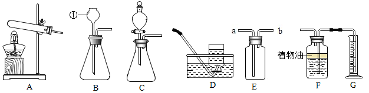

# Chemistry - 题目 147

**ID**: 411f89ec73f84298869c6310bd40cb61
**年级**: Grade 9
**难度**: Medium
**题型**: Experiment

## 题目
如图是初中化学实验室中的常见仪器图片,请回答下列问题（1）利用和D装置可以组合一套加热高锰酸钾制取氧气的装置,请你写出该反应的化学方程式:（2）用C做制取气体的发生装置和B相比,主要优点是:(填一条即可).​​​​​​​‌（3）用E装置收集氧气,气体需要从:(填a或b)端进入.（4）用F、G装置可以定量收集气体,若收集 CO_{2},则需在水面上方放一层植物油,原因是,G装置的作用为:

## 解答

1. （1）高锰酸钾为固体且反应需要加热，所以发生装置为A，高锰酸钾在加热条件下反应生成锰酸钾、二氧化锰和氧气；
2. 故答案为：A； ${\rm{2}}{\rm{K}}{\rm{M}}{\rm{n}}{\rm{O}}_{{\rm{4}}}\begin{array}{}{\underline{{\underline{{\rm{M}}{\rm{n}}{\rm{O}}{\rm{2}}}}}}\\\;\end{array}{\rm{K}}_{{\rm{2}}}{\rm{M}}{\rm{n}}{\rm{O}}_{{\rm{4}}}{\rm{+}}{\rm{M}}{\rm{n}}{\rm{O}}_{{\rm{2}}}{\rm{+}}{\rm{O}}_{{\rm{2}}}\uparrow $ 。
3. （2）C带有开关，可以控制加入液体的量，从而控制反应物浓度，控制反应速率；
4. 故答案为：可以控制反应速率。
5. （3）氧气密度比空气大，先在底部聚集，所以从长口a进气；
6. 故答案为：a。
7. （4）二氧化碳能溶于水，所以用植物油防止二氧化碳溶解，G通过量取排出水的体积，测得收集气体体积；
8. 故答案为：防止二氧化碳溶于水；测量气体体积。

## 知识点

**中文**:
  - 气体制取装置的探究
  - 高锰酸钾制取氧气

**English**:
  - Inquiry into Gas Generating Apparatus
  - Preparation of Oxygen using Potassium Permanganate

---
