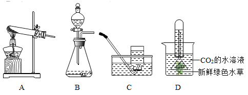

# Chemistry - 题目 240

**ID**: 55334cea2b7e47f29878439da562989b
**年级**: Grade 9
**难度**: Medium
**题型**: Experiment

## 题目
在实验室中，我们常用下图所示装置制取和收集某些气体。​​​​​​​‌(1)选取（选填“A”或“B”）作为制取氧气发生装置，则反应的化学方程式为。(2)小组实验时认为可以用C所示装置来收集CO_{2}，理由是。(3)将CO_{2}的水溶液转移至烧杯，并组装装置如图D所示，置于阳光下一段时闻，观察到有气泡产生，检验该气体的方法是。

## 解答

1. (1)
2. 装置A中有酒精灯，试管口有棉花，可用于加热高锰酸钾制取氧气，反应的化学方程式为： ${\rm{2}}{\rm{K}}{\rm{M}}{\rm{n}}{\rm{O}}_{{\rm{4}}}\begin{array}{}{\underline{{\underline{{\rm{Δ}}}}}}\\\;\end{array}{\rm{K}}_{{\rm{2}}}{\rm{M}}{\rm{n}}{\rm{O}}_{{\rm{4}}}{\rm{+}}{\rm{M}}{\rm{n}}{\rm{O}}_{{\rm{2}}}{\rm{+}}{\rm{O}}_{{\rm{2}}}↑$ ；装置B不需要加热，可应用于过氧化氢溶液在二氧化锰的催化下制取氧气，反应的化学方程式为： ${\rm{2}}{\rm{H}}_{{\rm{2}}}{\rm{O}}_{{\rm{2}}}\begin{array}{}{\underline{{\underline{{\rm{M}}{\rm{n}}{\rm{O}}_{{\rm{2}}}}}}}\\\;\end{array}{\rm{2}}{\rm{H}}_{{\rm{2}}}{\rm{O}}{\rm{+}}{\rm{O}}_{{\rm{2}}}\uparrow $ ；
3. (2)
4. 在实验室用排水法收集二氧化碳，由于二氧化碳溶于水的速度远小于逸出的速度，是完全可行的；
5. (3)
6. 水草发生光合作用，故产生的气体是氧气，检验氧气的方法是用带火星的木条伸入试管，观察木条复燃，则证明该气体是氧气。

## 知识点

**中文**:
  - 二氧化碳的检验与验满
  - 高锰酸钾制取氧气
  - 实验装置的选择

**English**:
  - Testing and Verification of CO2
  - Preparation of Oxygen using Potassium Permanganate
  - Selection of Experimental Apparatus

---
