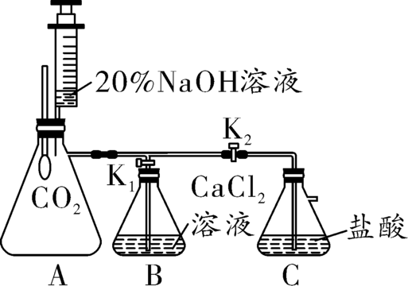

# Chemistry - 题目 80

**ID**: 6920def0c70e478d818301ebb7ddad00
**年级**: Grade 9
**难度**: Medium
**题型**: Experiment

## 题目
小明同学按图示装置验证CO_{2}和NaOH溶液发生了反应。​​​​​​​‌关闭K_{1}、K_{2}，将20% NaOH溶液注入装满CO_{2}的锥形瓶中，观察到气球胀大。(1)打开K_{1}，观察到的现象是。(2)关闭K_{1}，打开K_{2}，将注射器活塞向上拉，使C中液体进入A，写出一个可能发生的反应方程式。(3)实验结束后，测得A中溶液的pH＜7，则A中含有的溶质有（填化学式）。

## 解答

1. （1）关闭K_{1}、K_{2}，将20% NaOH溶液注入装满CO_{2}的锥形瓶中，二氧化碳与氢氧化钠反应生成碳酸钠和水，锥形瓶内气体减少，压强减小，打开K_{1}后，B中液体倒吸入A中，吸入的氯化钙和反应生成的碳酸钠反应生成碳酸钙沉淀，故观察到B中液体倒吸进入A中，A中产生白色沉淀；
2. （2）A中发生的反应有二氧化碳与氢氧化钠反应生成碳酸钠和水，氯化钙和碳酸钠反应生成碳酸钙和氯化钠，故A中的溶质有氢氧化钠，碳酸钠，碳酸钙和氯化钠，盐酸溶液能与氢氧化钠、碳酸钠、碳酸钙反应，故可能发生的反应方程式 ${\rm{N}}{\rm{a}}{{}_{{{2}}}}{\rm{C}}{\rm{O}}{{}_{{{3}}}}+{{2}}{\rm{H}}{\rm{C}}{\rm{l}}{\rm{=}}{{2}}{\rm{N}}{\rm{a}}{\rm{C}}{\rm{l}}+{\rm{H}}{{}_{{{2}}}}{\rm{O}}+{\rm{C}}{\rm{O}}{{}_{{{2}}}}\uparrow ；{\rm{N}}{\rm{a}}{\rm{O}}{\rm{H}}{{+}}{\rm{H}}{\rm{C}}{\rm{l}}{\rm{=}}{\rm{N}}{\rm{a}}{\rm{C}}{\rm{l}}+{\rm{H}}{{}_{{{2}}}}{\rm{O}}；\\{\rm{C}}{\rm{a}}{\rm{C}}{\rm{O}}{{}_{{{3}}}}+{{2}}{\rm{H}}{\rm{C}}{\rm{l}}{\rm{=}}{\rm{C}}{\rm{a}}{\rm{C}}{\rm{l}}{{}_{{{2}}}}+{\rm{H}}{{}_{{{2}}}}{\rm{O}}+{\rm{C}}{\rm{O}}{{}_{{{2}}}}\uparrow ；$
3. （3）实验结束后，测得A中溶液的pH＜7，说明A中溶液呈酸性，稀盐酸将碱性的碳酸钠和氢氧化钠反应完后还有剩余，故A中含有的溶质有剩余的HCl、反应生成的NaCl、CaCl_{2}。

## 知识点

**中文**:
  - 溶液的酸碱性与pH
  - 碱的化学性质
  - 盐的化学性质

**English**:
  - Acidity/Basicity of Solutions and pH
  - Chemical Properties of Bases
  - Chemical Properties of Salts

---
