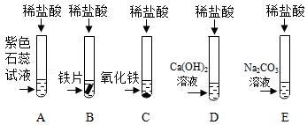

# Chemistry - 题目 143

**ID**: 9917892f425846358d62740e422382d2
**年级**: Grade 9
**难度**: Medium
**题型**: Experiment

## 题目
为探究盐酸的化学性质，某实验小组同学做了以下实验：(1)上述实验中，能观察到产生气泡的是(填字母序号)；(2)D中发生反应的化学方程式为；(3)将反应后D和E试管中的废液混合，观察到有气泡产生，最终出现白色沉淀。​​​​​​​‌则混合前D 中溶质的化学式为，由此证明D中发生了反应；（拓展与迁移）稀盐酸和稀硫酸有相似的化学性质，是因为它们的溶液中都存在。

## 解答

1. （1）A、紫色石蕊试液遇酸变红，故观察到溶液变红，不符合题意；
2. B、铁与稀盐酸反应生成氯化亚铁和氢气，有气泡产生，符合题意；
3. C、氧化铁与稀盐酸反应生成氯化铁和水，溶液变为黄色，不符合题意；
4. D、氢氧化钙与稀盐酸反应生成氯化钙和水，无明显现象，不符合题意；
5. E、碳酸钠与稀盐酸反应生成氯化钠、二氧化碳和水，有气泡产生，符合题意。
6. 故选BE；
7. （2）D中发生反应为氢氧化钙与稀盐酸反应生成氯化钙和水，该反应的化学方程式为： ${\rm{C}}{\rm{a}}\left ({{\rm{O}}{\rm{H}}}\right )_{{\rm{2}}}{\rm{+}}{\rm{2}}{\rm{H}}{\rm{C}}{\rm{l}}{\rm{=}}{\rm{C}}{\rm{a}}{\rm{C}}{\rm{l}}_{{\rm{2}}}{\rm{+}}{\rm{2}}{\rm{H}}_{{\rm{2}}}{\rm{O}}$ ；
8. D中发生的反应为： ${\rm{C}}{\rm{a}}\left ({{\rm{O}}{\rm{H}}}\right )_{{\rm{2}}}{\rm{+}}{\rm{2}}{\rm{H}}{\rm{C}}{\rm{l}}{\rm{=}}{\rm{C}}{\rm{a}}{\rm{C}}{\rm{l}}_{{\rm{2}}}{\rm{+}}{\rm{2}}{\rm{H}}_{{\rm{2}}}{\rm{O}}$ ，E中发生的反应为： ${\rm{N}}{\rm{a}}_{{\rm{2}}}{\rm{C}}{\rm{O}}_{{\rm{3}}}{\rm{+}}{\rm{2}}{\rm{H}}{\rm{C}}{\rm{l}}{\rm{=}}{\rm{2}}{\rm{N}}{\rm{a}}{\rm{C}}{\rm{l}}{\rm{+}}{\rm{C}}{\rm{O}}_{{\rm{2}}}\uparrow {\rm{+}}{\rm{H}}_{{\rm{2}}}{\rm{O}}$ ，将反应后D和E试管中的废液混合，观察到有气泡产生，最终出现白色沉淀，说明D中盐酸过量，E中碳酸钠过量，混合后，碳酸钠先与盐酸反应生成氯化钠、二氧化碳和水，待盐酸完全反应后，碳酸钠与氯化钙反应生成碳酸钙和氯化钠，故混合前D 中溶质的化学式为：HCl、CaCl_{2}；
9. 拓展与迁移：稀盐酸和稀硫酸有相似的化学性质，是因为它们的溶液中都存在H^{+}。

## 知识点

**中文**:
  - 探究酸碱的主要性质
  - 盐酸的性质与用途

**English**:
  - Investigating Properties of Acids and Bases
  - Properties and Uses of Hydrochloric Acid

---
