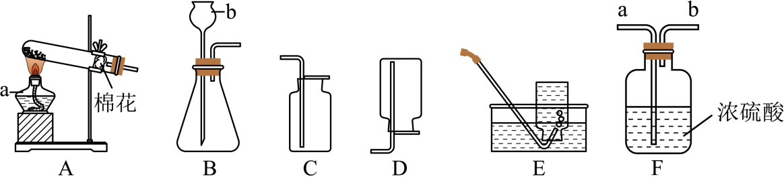
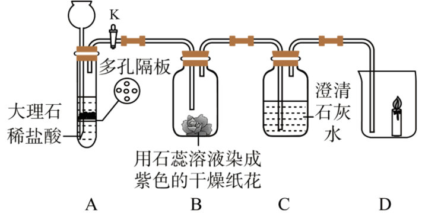

# Chemistry - 题目 33

**ID**: ab001525f3234669ac0b69a1a6bce6b5
**年级**: Grade 9
**难度**: Medium
**题型**: Experiment

## 题目
实验能充分发挥学生的主动性、创造性，学生自己探究、发现的乐趣是任何外来奖励无法比拟的。​​​​​​​‌请同学们根据题中提供的仪器和药品，完成下列实验。I、制备气体(1)仪器b的名称。(2)实验室用高锰酸钾制取并收集干燥氧气时，应选发生装置为，收集装置为，反应的化学方程式为：。(3)若将装置B和E连接制取氧气，B中发生反应的化学方程式：，洗气装置如图F 所示，浓硫酸可以吸收水分，为了除去氧气中混有的水蒸气，气体应从（选填“a”或“b”）端导管口通入。(4)实验室用固体大理石和稀盐酸常温下制取二氧化碳，二氧化碳能溶于水且能与水反应，密度比空气大。制取二氧化碳气体，应选发生装置为，收集装置为。Ⅱ、性质验证资料：1．石蕊是一种色素，遇酸溶液变成红色。2．二氧化碳不能使石蕊溶液染成的干燥纸花变红。水也不能使石蕊溶液染成的干燥纸花变红3．二氧化碳可以与水反应生成碳酸。【实验设计】甲同学设计了如图1所示装置（铁架台已略去）。【讨论交流】该小组同学对装置中可能出现的现象预测如下：乙同学认为B中纸花是干燥的，二氧化碳不能使其变红。【现象分析】当打开开关K，反应一段时间后：(5)B中干燥纸花变红，此现象与乙同学的预测不一致，原因是。(6)C中可以观察到的现象为。(7)D中蜡烛熄灭，证明二氧化碳具有的化学性质是。

## 解答

1. （1）仪器b的名称：长颈漏斗；
2. （2）实验室用高锰酸钾制取并收集干燥氧气时，高锰酸钾在加热条件下分解生成锰酸钾、二氧化锰、氧气，属于固体加热型反应，应选的发生装置是A；氧气密度比空气大、不易溶于水，可用向上排空气法或排水法收集，收集干燥的氧气，则需要采用向上排空气法，收集装置为C；反应的化学方程式为： ${\rm 2KMnO_{4}}\hspace{-0.5em}\begin{array}{}{\underline{{\underline{~{\rm{Δ}}~}}}}\atop{}\end{array}\hspace{-0.5em}{\rm K_{2}MnO_{4}+MnO_{2}+O_{2}↑}$ ；
3. （3）装置B属于固液常温型发生装置，若将装置B和E连接制取氧气，可以是利用过氧化氢溶液，过氧化氢在二氧化锰催化作用下快速分解生成水、氧气，反应的化学方程式： ${\rm 2H_{2}O_{2}}\hspace{-0.5em}\begin{array}{}{\underline{{\underline{~{\rm{M}}{\rm{n}}{\rm{O}}{{}_{{{2}}}}~}}}}\atop{}\end{array}\hspace{-0.5em}{\rm 2H_{2}O+O_{2}↑}$ ；浓硫酸可以吸收水分，为了除去氧气中混有的水蒸气，气体需通入浓硫酸中，应从a端导管口通入；
4. （4）实验室用固体大理石和稀盐酸常温下制取二氧化碳，属于固液常温型反应，应选的发生装置是B；二氧化碳能溶于水且能与水反应，密度比空气大，可用向上排空气法收集，应选的收集装置是C。
5. （5）根据资料，石蕊是一种色素，遇酸溶液变成红色；二氧化碳不能使石蕊溶液染成的干燥纸花变红，水也不能使石蕊溶液染成的干燥纸花变红；二氧化碳可以与水反应生成碳酸；装置A中稀盐酸含有水，大理石与稀盐酸反应生成二氧化碳，B中干燥纸花变红的原因是：产生的二氧化碳带有水蒸气，二氧化碳和水反应产生碳酸，碳酸使纸花变红；
6. （6）二氧化碳能与澄清石灰水中的氢氧化钙反应生成碳酸钙沉淀和水，二氧化碳能使澄清石灰水变浑浊，则C中可以观察到的现象为：澄清石灰水变浑浊。
7. （7）D中蜡烛熄灭，证明二氧化碳具有的化学性质是：不能燃烧也不支持燃烧。

## 知识点

**中文**:
  - 不燃烧也不支持燃烧
  - 过氧化氢制取氧气
  - 高锰酸钾制取氧气
  - 二氧化碳的制取原理
  - 二氧化碳与水的反应
  - 多功能瓶的使用

**English**:
  - Non-combustible and Non-supporting Combustion
  - Preparation of Oxygen using Hydrogen Peroxide
  - Preparation of Oxygen using Potassium Permanganate
  - Principles of CO2 Preparation
  - Reaction of Carbon Dioxide with Water
  - Use of Multi-functional Bottles

---
