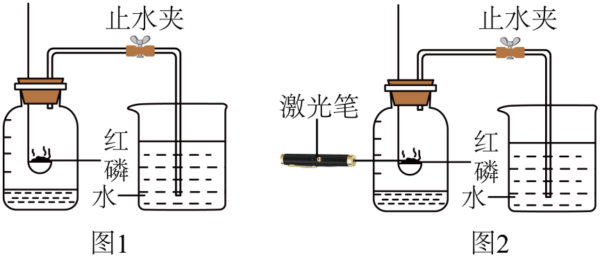
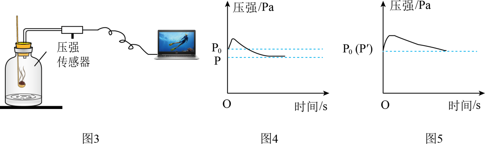

# Chemistry - 题目 299

**ID**: bec6fddbc2a4456590b48d5455224e50
**年级**: Grade 9
**难度**: Medium
**题型**: Experiment

## 题目
某化学兴趣小组的同学们设计了测定空气中氧气含量的实验,实验装置如图1所示。​​​​​​​‌ 实验步骤如下：①检查装置气密性；②在图1中集气瓶内加入少量水，并将水面上方空间分为5等份；③在燃烧匙内装入足量的红磷，将导管上的止水夹夹紧，在酒精灯上点燃红磷，并立即伸入集气瓶内，塞紧橡胶塞；④充分反应后，待集气瓶冷却至室温，打开止水夹。请回答下列问题。【基础设问】(1)该实验中红磷须稍过量，目的是。(2)步骤③中点燃红磷观察到的现象是。(3)实验结束，瓶内剩余气体的物理性质主要是，化学性质是。【能力设问】(4)已知：镁+氧气 ${\xrightarrow []{点燃}}$   氧化镁，镁+氮气 ${\xrightarrow []{点燃}}$   氮化镁(固体)，能否用镁条代替红磷测定空气中氧气的含量？，请说明理由：。(5)小明将图1实验中的点火方式改为图2所示的点火方式，改进后装置的优点是(答一点)。【数字化实验】(6)用图3所示装置测定空气中氧气的含量。图4和图5分别是红磷和木炭在装置内燃烧过程中装置内的气压随时间变化的关系图(装置气密性良好，P_{0}表示装置内起始气压，木炭在空气中燃烧生成二氧化碳气体)。请回答下列问题。①由图4可知红磷熄灭后，最终装置内的气压比起始气压小，请说明原因。②根据图4和图5中压强的变化，分析不能用木炭代替红磷测定空气中氧气含量的原因是。

## 解答

1. （1）红磷与氧气在点燃条件下反应生成五氧化二磷，为完全消耗集气瓶内氧气，使实验结果更准确，所以该实验中红磷须稍过量。故填：完全消耗集气瓶内氧气，使实验结果更准确。
2. （2）红磷与氧气在点燃条件下反应生成的五氧化二磷是白色固体，是放热反应，所以步骤③中点燃红磷观察到的现象是产生浓厚的白烟，放出热量。故填：产生浓厚的白烟，放出热量。
3. （3）实验结束，瓶内剩余气体主要是氮气，氮气的物理性质主要是难溶于水，化学性质是不燃烧，不支持燃烧。故填：难溶于水；不燃烧，不支持燃烧。
4. （4）根据镁和氧气点燃条件下反应生成氧化镁，镁和氮气点燃条件下反应生成氮化镁，即镁条燃烧不但消耗氧气也消耗氮气，这样会使气体减少的总量要大于容器体积的五分之一，使结果偏大，所以，不能用镁条代替红磷测定空气中氧气的含量。故填：不能或否；镁条燃烧不但消耗氧气也消耗氮气，这样会使气体减少的总量要大于容器体积的五分之一，使结果偏大。
5. （5）据图1实验中的点火方式和图2所示的点火方式可知，改进后装置实验结果更准确或更环保。故填：实验结果更准确。
6. （6）①由于实验中红磷与氧气反应生成五氧化二磷，即由于氧气被消耗，红磷熄灭后，最终装置内的气压比起始气压小。故填：氧气被消耗。
7. ②由于木炭燃烧生成二氧化碳气体，导致集气瓶内压强无明显变化，所以不能用木炭代替红磷测定空气中氧气含量。故填：木炭燃烧生成二氧化碳气体，导致集气瓶内压强无明显变化。

## 知识点

**中文**:
  - 测定空气中氧气含量
  - 测定空气中氧气含量的装置改进

**English**:
  - Measuring Oxygen Content in Air
  - Apparatus Improvement for Measuring Oxygen Content

---
