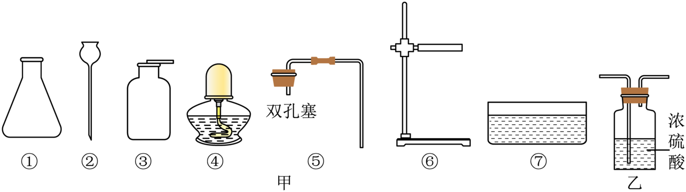

# Chemistry - 题目 73

**ID**: e0ad5b67f03d42a1b7731004f6afa39a
**年级**: Grade 9
**难度**: Medium
**题型**: Experiment

## 题目
化学小组同学在实验室里用下列实验仪器或装置进行实验，请你一起回答下列问题。​​​​​​​‌(1)甲图中仪器⑦的名称为。(2)实验室制取并收集一瓶二氧化碳，需要用到甲图的仪器有(填序号)，该反应的化学方程式为。(3)若用氯酸钾和二氧化锰反应，通过以上仪器制取并收集一瓶纯净的氧气，用于铁丝燃烧实验，需要补充的仪器为30度玻璃弯管、单孔塞、橡胶管和。(4)若收集的二氧化碳要干燥，则将气体从(选填“左”或“右”)导管通入装有浓硫酸的乙图装置。

## 解答

1. （1）仪器⑦的名称为水槽；
2. （2）实验室用石灰石或大理石与稀盐酸反应制取二氧化碳，该反应是固液不加热型，二氧化密度比空气大，溶于水，所以收集方法是向上排空气法，故选择的仪器是①②③⑤；大理石或石灰石与稀盐酸反应制取二氧化碳，同时生成氯化钙和水，方程式是${\rm {\rm{C}}{\rm{a}}{\rm{C}}{\rm{O}}{{}_{{\rm{3}}}}{\rm{+}}{\rm{2}}{\rm{H}}{\rm{C}}{\rm{l}}{\rm{=}}{\rm{C}}{\rm{a}}{\rm{C}}{\rm{l}}{{}_{{\rm{2}}}}{\rm{+}}{\rm{H}}{{}_{{\rm{2}}}}{\rm{O}}{\rm{+}}{\rm{C}}{\rm{O}}{{}_{{\rm{2}}}}\uparrow}$；
3. （3）氯酸钾和二氧化锰用于制取氧气，反应物为固体，且需要加热，因此需要加热发生装置，则需要补充试管，作为加热发生仪器；
4. （4）洗气装置导管长进短出，所以气体应从左边导入。

## 知识点

**中文**:
  - 二氧化碳的制取原理
  - 氯酸钾制取氧气
  - 多功能瓶的使用

**English**:
  - Principles of CO2 Preparation
  - Preparation of Oxygen using Potassium Chlorate
  - Use of Multi-functional Bottles

---
