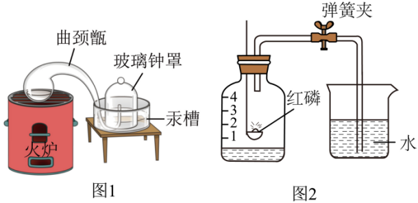

# Chemistry - 题目 101

**ID**: 04ae848c12374f6a83592ac5b9a5f984
**年级**: Grade 9
**难度**: Medium
**题型**: 填空与简答

## 题目
化学家拉瓦锡利用图1装置研究空气的成分，教材采用相同的科学思维设计了如图2装置进行实验来探究空气的成分。​​​​​​​‌（1）写出相关反应的化学方程式。(只写一个)（2）这两个实验中，相同的现象：一部分液体由另一个容器进入到了反应容器。请从反应容器内气体分子数目和气压两方面解释原因。（3）虽然两个实验所选试剂不同，但都达到了实验目的。请分析这两个实验所用试剂有哪些相似的化学性质。

## 解答

1. （1）图1实验中发生反应为汞和氧气在加热的条件下反应生成氧化汞，该反应的化学方程式为 ${{2}}{\rm{H}}{\rm{g}}{{+}}{\rm{O}}{{}_{{{2}}}}\hspace{-0.5em}\begin{array}{}{\underline{{\underline{~{\,}{\,}{\,}\Delta {\,}{\,}{\,}{\,}~}}}}\atop{}\end{array}\hspace{-0.5em}{{2}}{\rm{H}}{\rm{g}}{\rm{O}}$ ；
2. 图2实验中发生反应为红磷燃烧生成五氧化二磷，该反应的化学方程式为 ${{4}}{\rm{P}}+{{5}}{\rm{O}}{{}_{{{2}}}}\hspace{-0.5em}\begin{array}{}{\underline{{\underline{~~点燃~~}}}}\atop{}\end{array}\hspace{-0.5em}{{2}}{\rm{P}}{{}_{{{2}}}}{\rm{O}}{{}_{{{5}}}}$ ；
3. （2）这两个实验中，相同的现象是一部分液体由另一个容器进入到了反应容器。是由于反应消耗了氧气，装置内压强减小，从反应容器内气体分子数目和气压两方面解释原因是反应容器内气体分子数目减少，容器内气压减小；
4. （3）这两个实验中所用试剂为汞和红磷，它们的相似化学性质是只能与空气中的氧气反应，且生成物均是固体，故可用于测定空气中氧气的含量。

## 知识点

**中文**:
  - 测定空气中氧气含量

**English**:
  - Measuring Oxygen Content in Air

---
