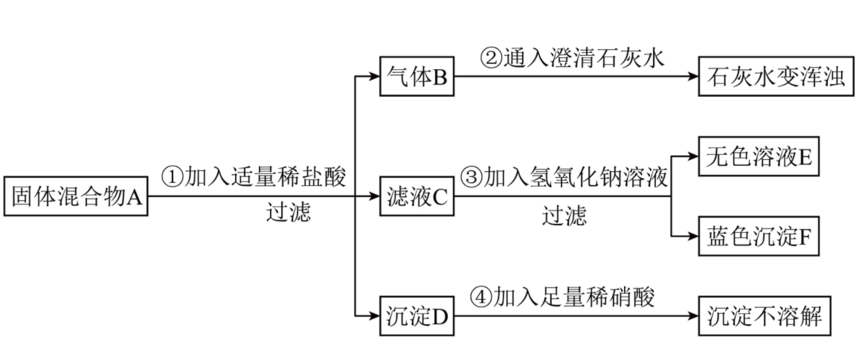

# Chemistry - 题目 184

**ID**: 101d4ce395ee485aa6a3e51a14f72de7
**年级**: Grade 9
**难度**: Medium
**题型**: 填空与简答

## 题目
现欲通过实验确定一固体混合物A的成分，已知其中可能含有NaCl、CuO、 ${\rm{N}}{\rm{a}}{{}_{2}}{\rm{C}}{\rm{O}}{{}_{3}}$ 、 ${\rm{B}}{\rm{a}}{\rm{S}}{\rm{O}}{{}_{4}}$ 四种物质中的两种或多种。​​​​​​​‌按图所示进行实验，出现的现象如图所示（设图中所有可能发生的反应均恰好完全反应）。试根据实验过程和发生的现象填写以下空白：(1)根据气体B推测原混合物中一定含有。(2)步骤③中所发生反应的化学方程式为。(3)根据以上信息，固体混合物A中不能确定有的物质是。(4)为确定（3）中物质是否存在，继续如下实验：取适量的固体混合物A加入足量的水溶解后过滤，得到滤液M；向滤液M中逐滴加入稀硝酸至过量，得到滤液N；向滤液N中滴加少量（写化学式）溶液，没有观察到明显的现象，证明这种物质不存在。最后得到的溶液中含有的离子有（写符号）。

## 解答

1. （1）碳酸钠和盐酸反应生成氯化钠、水和二氧化碳，二氧化碳能使澄清石灰水变浑浊，所以气体B是二氧化碳，原混合物中一定含有：Na_{2}CO_{3}；
2. （2）步骤③中发生的反应是氯化铜和氢氧化钠反应生成氢氧化铜沉淀和氯化钠，反应的化学方程式为： ${\rm{C}}{\rm{u}}{\rm{C}}{\rm{l}}{{}_{{{2}}}}{{+}}{{2}}{\rm{N}}{\rm{a}}{\rm{O}}{\rm{H}}{\rm{=}}{\rm{C}}{\rm{u}}\left ({{\rm{O}}{\rm{H}}}\right ){{}_{{{2}}}}\downarrow {{+}}{{2}}{\rm{N}}{\rm{a}}{\rm{C}}{\rm{l}}$ ；
3. （3）硫酸钡不能和盐酸、稀硝酸反应，氧化铜和盐酸反应生成氯化铜和水，氯化铜和氢氧化钠反应生成氢氧化铜沉淀和氯化钠，所以原固体混合物A中一定含有：CuO、Na_{2}CO_{3}、BaSO_{4}，氯化钠能溶于水，不能和盐酸、氢氧化钠反应，根据以上信息，固体混合物A中不能确定有的物质是：NaCl。
4. （4）为确定氯化钠是否存在，继续如下实验：取适量的固体混合物A加入足量的水溶解后过滤，得到滤液M，其中一定含有碳酸钠；向滤液M中逐滴加入稀硝酸至过量，得到滤液N，其中含有生成的硝酸钠和过量的硝酸；向滤液N中滴加少量AgNO_{3}溶液，没有观察到明显的现象，证明氯化钠不存在。最后得到的溶液中含有硝酸钠、硝酸、硝酸银，所含离子有：Na^{+}、H^{+}、Ag^{+}、NO_{3}^{-}_{。}

## 知识点

**中文**:
  - 碱的化学性质
  - 酸的化学性质
  - 碳酸钠、碳酸氢钠和碳酸钙

**English**:
  - Chemical Properties of Bases
  - Chemical Properties of Acids
  - Sodium Carbonate, Sodium Bicarbonate, and Calcium Carbonate

---
