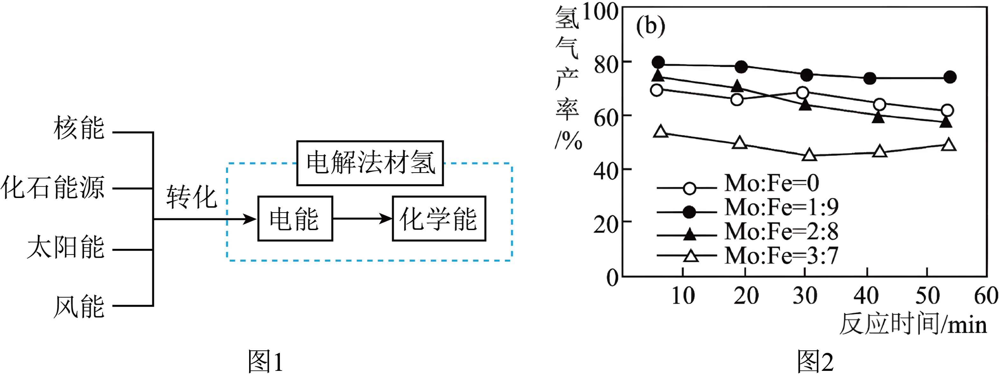

# Chemistry - 题目 272

**ID**: 358951cc6c40473cabb53643b0b40583
**年级**: Grade 9
**难度**: Medium
**题型**: 填空与简答

## 题目
目前制氢的方法主要有化石能源制氢、电解水制氢和乙醇裂解制氢等。​​​​​​​‌由化石能源制得的H_{2}中含有CO，利用液氮的低温可将CO液化分离，从而获得纯净的H_{2}。电解法制氢的能量转化如图1所示。乙醇裂解制氢会受到反应温度、催化剂种类等多种因素的影响。科研人员研究相同温度下裂解乙醇制备氢气时，催化剂中Mo与Fe最佳质量比的实验结果如图2，氢气产率越高，说明催化剂效果越好。（1）目前制氢的方法主要有化石能源制氢、制氢和乙醇裂解制氢等。（2）化石能源包括煤、和天然气。天然气燃烧的化学方程式为。（3）利用液氮的低温能将H_{2}与CO分离，说明H_{2}的沸点比CO的沸点（填“低”或“高”）。（4）氢能源没有污染，氢气燃烧的化学方程式为。（5）根据图2可知，在相同温度下、相同时间内，裂解乙醇制氢气所需的催化剂中Mo-Fe的最佳质量比为。

## 解答

1. （1）由题中信息可知，目前制氢的方法主要有化石能源制氢、电解水制氢和乙醇裂解制氢等。
2. （2）化石能源包括煤、石油和天然气；天然气主要成分是甲烷，甲烷燃烧生成水、二氧化碳，所以天然气燃烧的化学方程式为： ${\rm{C}}{\rm{H}}{{}_{{{4}}}}{{+}}{{2}}{\rm{O}}{{}_{{{2}}}}\hspace{-0.5em}\begin{array}{}{\underline{{\underline{~~点燃~~}}}}\atop{}\end{array}\hspace{-0.5em}{\rm{C}}{\rm{O}}{{}_{{{2}}}}{{+}}{{2}}{\rm{H}}{{}_{{{2}}}}{\rm{O}}$ 。
3. （3）由化石能源制得的H_{2}中含有CO，利用液氮的低温可将CO液化分离，从而获得纯净的H_{2}，说明H_{2}的沸点比CO的沸点低。
4. （4）氢能源没有污染，氢气燃烧生成水，反应的化学方程式为： ${{2}}{\rm{H}}{{}_{{{2}}}}{{+}}{\rm{O}}{{}_{{{2}}}}\hspace{-0.5em}\begin{array}{}{\underline{{\underline{~~点燃~~}}}}\atop{}\end{array}\hspace{-0.5em}{{2}}{\rm{H}}{{}_{{{2}}}}{\rm{O}}$ 。
5. （5）根据图2可知，在相同温度下、相同时间内，裂解乙醇制氢气所需的催化剂中Mo-Fe的最佳质量比为1：9。

## 知识点

**中文**:
  - 化石能源
  - 氢气的性质及纯度检验
  - 科普阅读
  - 甲烷

**English**:
  - Fossil Fuels
  - Properties and Purity Testing of Hydrogen
  - Popular Science Reading
  - Methane

---
