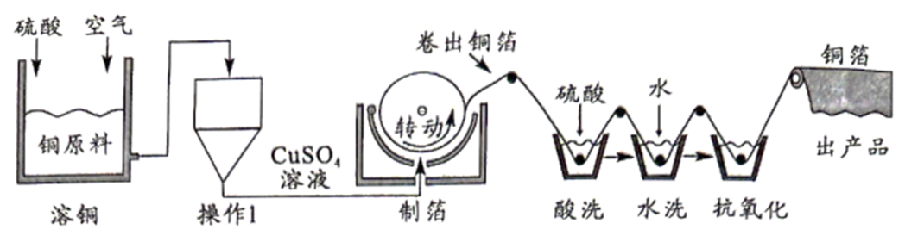
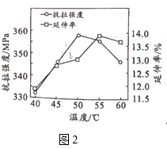

# Chemistry - 题目 3

**ID**: 6b61f1c60beb4562bffcf04777d9a609
**年级**: Grade 9
**难度**: Medium
**题型**: 填空与简答

## 题目
铜箔在新能源汽车电池制造等领域有重要应用。​​​​​​​‌一种制造铜箔工艺的主要工序如图1所示。图1(1)“溶铜”前，粉碎处理铜原料的目的是。(2)“溶铜”中，存在Cu与O_{2}生成CuO的反应，该反应属于(填基本反应类型)，“操作1”的目的是除去难溶性固体杂质，该操作名称为。(3)“制箔”中，发生反应的化学方程式： ${\rm 2CuSO_{4}+2H_{2}O}\hspace{-0.5em}\begin{array}{}{\underline{{\underline{~通{\rm{电}}~}}}}\atop{}\end{array}\hspace{-0.5em}{\rm 2Cu+O_{2}↑+2X，X}$ 的化学式为，物质X可用于和工序。(4)“制箔”中，需生产抗拉强度大于355MPa且延伸率大于13.5%的铜箔，据图2可知，温度应控制在内(填字母)。a、45~49℃           b、50~52℃          c、53~55℃         d、56~60℃(5)“酸洗”后，用熟石灰中和酸性废液，其反应的化学方程式为。

## 解答

1. （1）“溶铜”前，粉碎处理铜原料的目的是增大反应物之间的接触面积，使反应更快更充分；
2. （2）“溶铜”中，存在Cu与O_{2}生成CuO的反应，该反应符合“多变一”的特点，属于化合反应；
3. “操作1”的目的是除去难溶性固体杂质，则该操作实现了固液分离，名称为过滤；
4. （3）根据质量守恒定律，化学反应前后，原子的种类和数目不变，反应物中含Cu、S、O、H的个数分别是2、2、10、4，生成物中含Cu、S、O、H的个数分别是2、0、2、0，生成物中还应含2个S、8个O、4个H，X的化学式为H_{2}SO_{4}；
5. 溶铜过程中，铜与氧气反应生成氧化铜，氧化铜与硫酸反应生成硫酸铜和水，且由图可知，酸洗过程中，也用到硫酸，物质X可用于溶铜和酸洗工序；
6. （4）由图可知，“制箔”中，需生产抗拉强度大于355MPa且延伸率大于13.5%的铜箔，需要温度控制在53~55℃ ；
7. 故选c；
8. （5）“酸洗”后，用熟石灰中和酸性废液，其反应为氢氧化钙和硫酸反应生成硫酸钙和水，该反应的化学方程式为 ${\rm{C}}{\rm{a}}{\rm{(}}{\rm{O}}{\rm{H}}{\rm{)}}{{}_{{{2}}}}{{+}}{\rm{H}}{{}_{{{2}}}}{\rm{S}}{\rm{O}}{{}_{{{4}}}}{\rm{=}}{\rm{C}}{\rm{a}}{\rm{S}}{\rm{O}}{{}_{{{4}}}}{{+}}{{2}}{\rm{H}}{{}_{{{2}}}}{\rm{O}}$ 。

## 知识点

**中文**:
  - 化合反应
  - 质量守恒定律的内容与应用
  - 化学方程式的书写与配平
  - 过滤操作

**English**:
  - Combination Reaction
  - Content and Application of Law of Conservation of Mass
  - Writing and Balancing Chemical Equations
  - Filtration Operation

---
