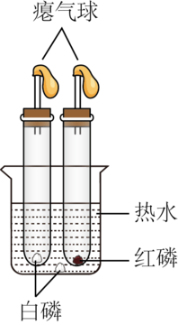

# Chemistry - 题目 122

**ID**: 6e9e2c78db684c87a56622ef48d3505f
**年级**: Grade 9
**难度**: Medium
**题型**: 填空与简答

## 题目
燃烧是人类最早利用的化学反应之一，如图是某化学活动小组围绕探究燃烧条件与灭火原理而设计的实验装置，请回答下列问题：（1）该装置的优点是什么？（答一点）（2）通过实验中的现象可得出燃烧的条件是什么？​​​​​​​‌

## 解答

1. （1）该实验是在密闭的容器内进行的，生成的五氧化二磷不会扩散到空气中造成污染；
2. （2）在实验中发现，烧杯的热水中的白磷没有燃烧，试管中的白磷发生了燃烧，证明了燃烧需要氧气；而试管中的红磷没有发生燃烧，证明了燃烧需要温度达到可燃物的着火点。

## 知识点

**中文**:
  - 燃烧的条件

**English**:
  - Conditions of Combustion

---
