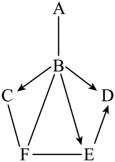

# Chemistry - 题目 8

**ID**: 9c43553bab224659b84530353ac85a8f
**年级**: Grade 9
**难度**: Medium
**题型**: 填空与简答

## 题目
现有A、B、C、D、E、F六种初中化学常见的物质，除A外，其余均为单质，且B是使用最广泛的金属，C、E为气体，它们之间的部分反应及转化关系如图所示，短线“—”表示两种物质可以发生化学反应，箭头“→”表示一种物质能转化为另一种物质。​​​​​​​‌请回答下列问题：(1)写出C、D物质的化学式：C，D。(2)B和E反应的化学方程式。(3)上述反应及转化关系，体现了B的条化学性质；(4)若A由三种元素组成，则A不能是。(填序号)①HCl            ②AgNO_{3}③KNO_{3}

## 解答

1. （1）据分析可知C是氢气化学式为H_{2，}D是铜化学式为Cu；
2. （2）据分析可知B和E反应为铁在点燃的条件下与氧气反应生成四氧化三铁，故化学反应方程式为 ${{3}}{\rm{F}}{\rm{e}}{{+}}{{2}}{\rm{O}}{{}_{{{2}}}}\hspace{-0.5em}\begin{array}{}{\underline{{\underline{~~点燃~~}}}}\atop{}\end{array}\hspace{-0.5em}{\rm{F}}{\rm{e}}{{}_{{{3}}}}{\rm{O}}{{}_{{{4}}}}$ ；
3. （3）据分析可知上述反应及转化关系，体现了B的3条化学性质（分别为铁能与氧气反应，铁能与酸反应，铁能与盐溶液反应）；
4. （4）据分析可知A是盐酸（硫酸）或金属活动性排在铁后的盐溶液，钾的活动性比铁强，故A不可能是③，若A由三种元素组成，则A不可能是①，故填①③。

## 知识点

**中文**:
  - 金属与酸反应
  - 铁在氧气中的燃烧及其实验
  - 金属材料的应用
  - 金属活动性顺序

**English**:
  - Reaction of Metals with Acids
  - Combustion of Iron in Oxygen and Experiment
  - Applications of Metal Materials
  - Metal Activity Series

---
