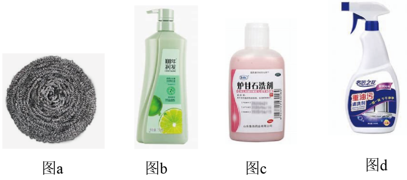

# Chemistry - 题目 322

**ID**: a2310dae327048ee873ad4dd19587757
**年级**: Grade 9
**难度**: Medium
**题型**: 填空与简答

## 题目
洗器与洗剂在生活中得到广泛应用。​​​​​​​‌(1)图a钢丝球洗器属于(填“金属材料”或“复合材料”)。(2)图b洗发剂去除油污是利用(填“溶解”或“乳化”)原理。(3)图c炉甘石洗剂中的ZnO能释放具有杀菌作用的锌离子，锌离子符号为。(4)图d为去污剂。配制500g含NaOH为4%的去污剂需NaOH质量为g。

## 解答

1. （1）金属材料包括纯金属和合金，钢丝球是由高品质的碳素钢丝编制而成的，属于金属材料；
2. （2）洗剂能使油污在水中分散成无数细小的液滴，而不聚集成大的油珠，从而使油和水不再分层，所形成的乳浊液稳定性增强，随水流走；图b洗发剂去除油污是利用乳化原理；
3. （3）离子的表示方法是在表示该离子的元素符号（或原子团）右上角，标出该离子所带的正负电荷数，数字在前，正负符号在后，带1个电荷时，1要省略；锌离子符号为为 $Zn{^{2+}}$ ；
4. （4）溶质质量=溶液的质量×溶质质量分数，配制500g含NaOH为4%的去污剂，需NaOH质量=500g×4%=20g 。

## 知识点

**中文**:
  - 乳化现象
  - 离子符号的书写与含义
  - 配制一定溶质质量分数的溶液
  - 常见的合金

**English**:
  - Emulsification Phenomenon
  - Writing and Meaning of Ion Symbols
  - Preparation of Solutions with Specific Mass Fraction
  - Common Alloys

---
