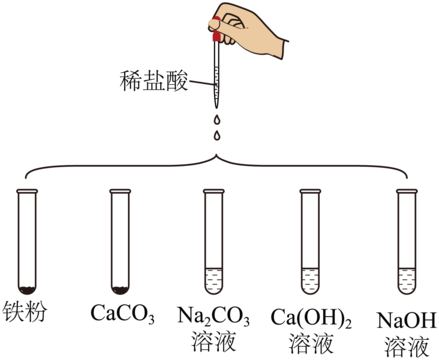

# Chemistry - 题目 151

**ID**: c0fdd2da98cf4e01a358dc3c86e8c2fd
**年级**: Grade 9
**难度**: Medium
**题型**: 填空与简答

## 题目
小科在研究酸的化学性质时。​​​​​​​‌做了如图所示的五个实验（A~E为装置代号）。(1)实验过程中有气泡产生的试管是（填装置代号）。(2)实验时，某试管中出现了明显的实验现象，向该试管中滴加酚酞溶液，溶液变红。据此推断，该试管中最初发生的反应为（用化学方程式表示）。(3)五个实验完成后，小科又进行了如下实验：在上述五支反应后的试管中，抽取两支试管内的溶液进行混合，观察到先产生气体，后出现白色沉淀；将混合后的物质过滤，得到滤液X，向滤液X滴加无色酚酞试液，发现溶液不变色。则滤液X中，溶质可能为（除酚酞外）（填字母序号）。

## 解答

1. （1）铁与稀盐酸反应生成氯化亚铁与氢气，则A试管中反应后有气泡产生；碳酸钙与稀盐酸反应生成氯化钙、水与二氧化碳，则B试管中反应后有气泡产生；碳酸钠与稀盐酸反应生成氯化钠、水与二氧化碳，则C试管中反应后有气泡产生；氢氧化钙与稀盐酸反应生成氯化钙与水，则D试管中反应无明显现象；氢氧化钠与稀盐酸反应生成氯化钠与水，则E试管中反应后无明显现象；则实验过程中ABC试管中有气泡产生；
2. （2）根据上述分析可知ABC试管中反应后有气泡产生，CE试管反应后无明显现象；碱性溶液能使酚酞试剂变红色，碳酸钠的溶液为碱性，若C试管中碳酸钠过量，则反应后溶液中溶质为Na_{2}CO_{3}、NaCl，溶液呈碱性，能使无色酚酞试剂变红色；故该试管为C，其中碳酸钠与稀盐酸反应的化学方程式为：Na_{2}CO_{3}+2HCl=CaCl_{2}+H_{2}O+CO_{2}；
3. （3）在上述五支反应后的试管中，抽取两支试管内的溶液进行混合，观察到先产生气体，后出现白色沉淀；根据实验中的物质可知，反应只有CO_{2}或H_{2}产生；白色沉淀只能为CaCO_{3}白色沉淀；实验中两溶液混合后先产生气体，反应后产生白色沉淀，则气体只能为CO_{2}，沉淀为CaCO_{3}，故两支试管为C与D反应后的溶液混合，且C中Na_{2}CO_{3}有剩余，溶液中溶质为NaCl、Na_{2}CO_{3}；D试管中HCl有剩余，溶液中溶质为HCl、CaCl_{2}；两试管混合后，先产生气泡后产生白色沉淀，故混合后反应中HCl被消耗完，且反应后的滤液中滴加无色酚酞试剂不变色，则说明Na_{2}CO_{3}反应完；NaCl、CaCl_{2}的溶液呈中性，若CaCl_{2}过量则反应后溶液的溶质为CaCl_{2}、NaCl，若CaCl_{2}与Na_{2}CO_{3}恰好反应完，则反应后溶液中溶质为NaCl；
4. 故选AC。

## 知识点

**中文**:
  - 化学方程式的书写与配平
  - 酸的化学性质

**English**:
  - Writing and Balancing Chemical Equations
  - Chemical Properties of Acids

---
