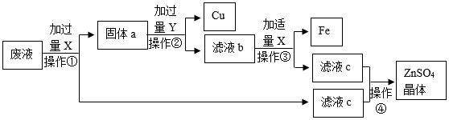

# Chemistry - 题目 200

**ID**: 7e55e59a39a84334af4f742d31920fdd
**年级**: Grade 9
**难度**: Medium
**题型**: Flowchart

## 题目
某工厂排放的废液中含有 ${\rm{C}}{\rm{u}}{\rm{S}}{\rm{O}}_{{\rm{4}}}$ ， ${\rm{F}}{\rm{e}}{\rm{S}}{\rm{O}}_{{\rm{4}}}$ 和 ${\rm{Z}}{\rm{n}}{\rm{S}}{\rm{O}}_{{\rm{4}}}$ 三种溶质，为减少水质污染和节约资源。​​​​​​​‌从废液中回收硫酸锌、金属铁和铜，其工艺流程如下图所示：(1)操作①的名称是；操作④中应用到的玻璃仪器是。(2)固体a的成分是；写出固体a加入Y时，有关反应的化学方程式。(3)铜和铁常用于制作导线，因为铜和铁都具有。

## 解答

1. (1)
2. 操作①是将固体和液体分开，名称是过滤；操作④是蒸发操作，用到的玻璃仪器是玻璃棒；
3. (2)
4. 根据流程图可知，实验最终回收到的是硫酸锌晶体，因此加过量X为锌，固体a的成分是反应生成的铁、铜和过量的锌；固体a加入Y是稀硫酸，稀硫酸和铁反应生成硫酸亚铁和氢气，反应的化学方程式为：Fe+H_{2}SO_{4}=FeSO_{4}+H_{2}↑；稀硫酸和锌反应生成硫酸锌和氢气，反应的化学方程式为：Zn+H_{2}SO_{4}=ZnSO_{4}+H_{2}↑；
5. (3)
6. 铜和铁常用于制作导线，因为铜和铁都具有导电性。

## 知识点

**中文**:
  - 金属与盐溶液反应
  - 金属的物理性质
  - 金属与酸反应

**English**:
  - Reaction of Metals with Salt Solutions
  - Physical Properties of Metals
  - Reaction of Metals with Acids

---
