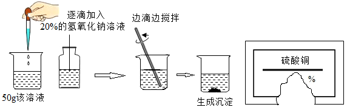
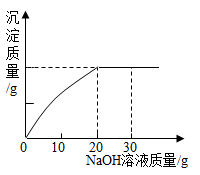

# Chemistry - 题目 131

**ID**: 2d41c2a645494be9846bba0982cf28a4
**年级**: Grade 9
**难度**: Medium-Hard
**题型**: Calculation

## 题目
某同学在实验室发现一瓶标签残缺的硫酸铜溶液。​​​​​​​‌为了测定此溶液的溶质质量分数，他取出50g该溶液，进行了下面如图所示的实验。反应过程中生成沉淀的质量与所用氢氧化钠溶液质量的关系如下图所示。请你仔细分析此关系图，并进行计算。（1）当滴入氢氧化钠溶液g时，硫酸铜与氢氧化钠恰好完全反应。（2）计算此硫酸铜溶液中溶质的质量分数（写出解题过程）。

## 解答

1. （1）由图可知，当滴入氢氧化钠的质量为20g时，硫酸铜与氢氧化钠完全反应。
2. （2）设50g该溶液中硫酸铜的质量为x
3. $\begin{array}{}{\rm{2}}{\rm{\;}}{\rm{N}}{\rm{a}}{\rm{O}}{\rm{H}}{\rm{+}}\\{\rm{8}}{\rm{0}}\\{\rm{2}}{\rm{0}}{\rm{g}}\times {\rm{2}}{\rm{0}}{\rm{\%}}\end{array}\begin{array}{}{\rm{C}}{\rm{u}}{\rm{S}}{\rm{O}}_{{\rm{4}}}{\rm{=}}\\{\rm{1}}{\rm{6}}{\rm{0}}\\{\rm{x}}\end{array}\begin{array}{}{\rm{N}}{\rm{a}}_{{\rm{2}}}{\rm{S}}{\rm{O}}_{{\rm{4}}}{\rm{+}}\\\\\;\end{array}\begin{array}{}{\rm{C}}{\rm{u}}（{\rm{O}}{\rm{H}}）_{{\rm{2}}}\downarrow \\\\\;\end{array}$
4. $\frac {80}{20{\rm{g}}\times 20{\rm{\%}}}{\rm{=}}\frac {160}{{\rm{x}}}$  解得x=8g
5. 故硫酸铜溶液中溶质的质量分数为： $\frac {8{\rm{g}}}{50{\rm{g}}}$  ×100%=16%。

## 知识点

**中文**:
  - 复分解反应
  - 溶质的质量分数

**English**:
  - Double Displacement Reaction
  - Mass Fraction of Solute

---
