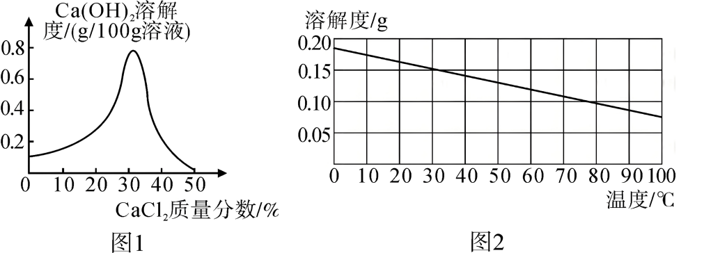

# Chemistry - 题目 216

**ID**: 3ec37d51864649b58a8bb28a13a50b0f
**年级**: Grade 9
**难度**: Medium-Hard
**题型**: Comprehensive

## 题目
天然气的主要成分为CH_{4}，含少量SO_{2}、COS(羰基硫)等含硫物质，需进行脱除。​​​​​​​‌(1)天然气属于(填“可再生”或“不可再生”)能源，SO_{2}任意排放会造成酸雨，酸雨的危害有(写一种即可)。用CAL液脱除SO_{2.}CAL液是向CaCl_{2}溶液中添加Ca(OH)_{2}所制得的溶液。图1为常温下Ca(OH)_{2}在不同浓度CaCl_{2}溶液中的溶解度曲线，图2为Ca(OH)_{2}在水中的溶解度曲线。(2)常温下制备CAL液时，应选取质量分数约为(填字母)的CaCl_{2}溶液。

## 解答

1. （1）天然气在短时间内不能从自然界中得到补充，属于不可再生能源；
2. 酸雨的危害：腐蚀建筑物等；
3. （2）由图1可知，常温下氯化钙的溶质质量分数为30%时，氢氧化钙在氯化钙溶液中的溶解度最大，则常温下制备CAL液时，应选取质量分数为30%的氯化钙溶液，故选：C；
4. （3）氢氧化钙能和二氧化硫反应，对比图1、2可知，常温下CAL液中，氢氧化钙的溶解度较大，则常温下用CAL液吸收SO_{2}比用石灰乳吸收快，故填：常温下氢氧化钙在CAL液中的溶解度较大；
5. （4） $\left ({NH{{}_{4}}}\right ){{}_{2}}SO{{}_{4}}$ 中含有氮、磷、钾三种营养元素中的氮元素，属于氮肥，则 $\left ({NH{{}_{4}}}\right ){{}_{2}}SO{{}_{4}}$ 在农业生产中的用途是作氮肥；
6. （5）在模拟吸收时使用多孔球泡(图4)，其目的是增大反应物的接触面积，加快吸收速率，使吸收更充分；
7. （6）二氧化硫与亚硫酸钠、水反应生成亚硫酸氢钠，化学方程式为 ${\rm{N}}{\rm{a}}{{}_{{{2}}}}{\rm{S}}{\rm{O}}{{}_{3}}{{+}}{\rm{S}}{\rm{O}}{{}_{{{2}}}}{{+}}{\rm{H}}{{}_{2}}{\rm{O}}={{2}}{\rm{N}}{\rm{a}}{\rm{H}}{\rm{S}}{\rm{O}}{{}_{{{3}}}}$ ；
8. （7）亚硫酸氢钠和水在通电条件下反应生成亚硫酸钠、硫酸和气体单质a，在该反应中，硫元素由+4价转化为+6价，化合价升高，故一定还有化合价下降，如果生成的是氧气，氧元素化合价升高，则不可能生成氧气，故气体a应是氢气；
9. “电解”过程电能转化为化学能；
10. （8）与氨脱硫法相比，该方法模拟脱除 ${\rm{S}}{\rm{O}}{{}_{2}}$ 的优点是无副产物氨气排放，环保性更好；
11. （9）若在催化剂中掺杂NaOH有利于COS的脱除，原因可能是氢氧化钠能与 ${\rm{C}}{\rm{O}}{{}_{2}}$ 、 ${\rm{H}}{{}_{{{2}}}}{\rm{S}}$ 反应，使反应向生成 ${\rm{C}}{\rm{O}}{{}_{2}}$ 和 ${\rm{H}}{{}_{{{2}}}}{\rm{S}}$ 的方向进行，从而提高COS的脱除效率。

## 知识点

**中文**:
  - 化石能源
  - 溶解度曲线
  - 常见化肥的种类和用途

**English**:
  - Fossil Fuels
  - Solubility Curve
  - Types and Uses of Common Fertilizers

---
