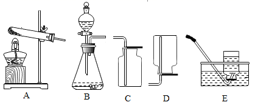
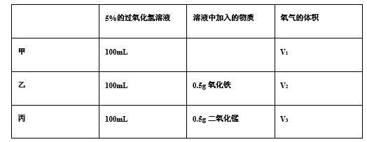

# Chemistry - 题目 61

**ID**: 4f9db07c79a944fd83e624feb8997e01
**年级**: Grade 9
**难度**: Medium-Hard
**题型**: Comprehensive

## 题目
以下是实验室制取氧气可能用到的装置：（1）实验室用氯酸钾和二氧化锰的混合物制取并收集较纯净的氧气，反应化学方程式为，可选择的装置组合为（填字母A~E）；实验结束时，甲、乙、丙三个操作正确的先后顺序为。​​​​​​​‌甲．熄灭酒精灯      乙．松开铁夹，移走试管      丙．把导气管从水槽中取出（2）某同学用E装置收集氧气，观察到时，说明氧气已经收集满，若他用此方法收集的氧气中混有空气，导致这一结果可能的原因是（写出一种即可）。（3）实验室用双氧水和二氧化锰制取氧气，选用装置B为发生装置。实验过程中反应较为剧烈，下列措施合理的是。a．堵住导管      b．换用体积较小的锥形瓶      c．减慢液体滴加的速度（4）某小组同学设计实验，探究氧化铁能否加快过氧化氢的分解速率，并与二氧化锰的催化效果进行比较。甲、乙、丙三位同学同时进行过氧化氢的分解与气体的收集实验，实验时间均以30s为准（过氧化氢均未全部分解），其他可能影响实验的因素均已忽略。相关数据如下：I．三位同学应选择上面的装置（填编号）收集氧气，请写出理由。II．实验过程中操作步骤正确的为（选填“a”或“b”）。a．先将发生装置B和所选收集装置的导气管连接好，后向反应容器中加入双氧水b．先向反应容器中加双氧水，等装置内空气完全排出后，将发生装置B和所选收集装置的导气管连接好（5）现需制取0.2mol氧气，至少需要过氧化氢的质量为（根据化学方程式计算）。

## 解答

1. （1）
2. 氯酸钾在二氧化锰催化作用下生成水和氧气，化学方程式 $2{\rm{K}}{\rm{C}}{\rm{l}}{\rm{O}}_{3}\begin{array}{}{\underline{{\underline{{\rm{M}}{\rm{n}}{\rm{O}}_{2}}}}}\\Δ\end{array}2{\rm{K}}{\rm{C}}{\rm{l}}{\rm{+}}{\rm{3}}{\rm{O}}_{{\rm{2}}}\uparrow $ ，该反应需要加热，发生装置选A，氧气不易溶于水，收集装置选E才能得到较纯净氧气，装置组合选AE，实验结束时，为防止水倒吸入试管，试管炸裂，把导气管从水槽中取出，然后熄灭酒精灯，最后松开铁夹，移走试管，故填： $2{\rm{K}}{\rm{C}}{\rm{l}}{\rm{O}}_{3}\begin{array}{}{\underline{{\underline{{\rm{M}}{\rm{n}}{\rm{O}}_{2}}}}}\\Δ\end{array}2{\rm{K}}{\rm{C}}{\rm{l}}{\rm{+}}{\rm{3}}{\rm{O}}_{{\rm{2}}}\uparrow $ ；AE；丙甲乙。
3. （2）
4. 排水法收集氧气，观察到瓶口有气泡冒出时，说明氧气已经收集满，若他用此方法收集的氧气中混有空气，导致这一结果可能的原因是一有气泡冒出就开始收集气体（或收集气体前，瓶中未装满水），故填：瓶口有气泡冒出；一有气泡冒出就开始收集气体（或收集气体前，瓶中未装满水）。
5. （3）
6. 实验室用双氧水和二氧化锰制取氧气，选用装置B为发生装置。实验过程中反应较为剧烈，应减慢液体滴加的速度，故选：C。
7. （4）
8. I．实验要测定氧气体积，为了便于观察故三位同学应选择上面的装置E收集氧气，故填：E；便于观察。
9. II．实验要测定氧气体积，故实验过程中操作步骤正确的为先将发生装置B和所选收集装置的导气管连接好，后向反应容器中加入双氧水，故选：a。
10. （5）
11. 见答案

## 知识点

**中文**:
  - 影响化学反应速率的因素探究
  - 装置的选用与安装
  - 气体制取装置的探究
  - 过氧化氢制取氧气
  - 氯酸钾制取氧气
  - 氧气的检验与验满

**English**:
  - Inquiry into Factors Affecting Reaction Rate
  - Selection and Assembly of Apparatus
  - Inquiry into Gas Generating Apparatus
  - Preparation of Oxygen using Hydrogen Peroxide
  - Preparation of Oxygen using Potassium Chlorate
  - Testing and Verification of Oxygen

---
