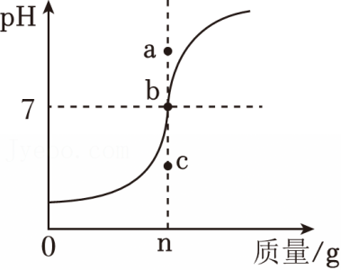
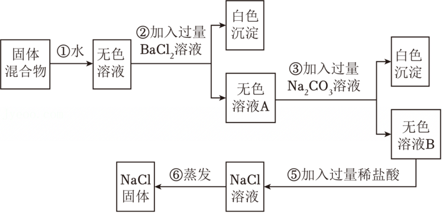

# Chemistry - 题目 204

**ID**: 5ed33596802743eba7bd2309999e315e
**年级**: Grade 9
**难度**: Medium-Hard
**题型**: 综合应用题。（10分）

## 题目
酸、碱、盐是生活中常见的化合物。​​​​​​​‌（1）在实验室常用浓硫酸做干燥剂，这是因为浓硫酸具有（填选项字母）。a．氧化性b．吸水性c．酸性d．脱水性（2）用氢氧化钙中和一定量的盐酸时，溶液的pH与加入的氢氧化钙质量的关系如图所示。①该反应的化学方程式为；b点溶液中粒子的符号为。②当盐酸质量不变，若把氢氧化钙换为烧碱进行该实验，当加入烧碱ng时，溶液的pH可能处于（填“a”“b”或“c”）点。（3）某粗盐样品中可能含有杂质氯化钙、硫酸钠中的一种或两种，为了确定其成分，并对其提纯，某同学进行了如下实验步骤，并记录了实验现象，根据图示信息回答问题。①粗盐样品中一定含有的杂质是。②写出步骤③中加入碳酸钠溶液时，一定发生的反应的化学方程式。③写出步骤⑥中玻璃棒的作用。（4）某化验室用20%的NaOH溶液洗涤一定量石油产品中的残余H_{2}SO_{4}，消耗NaOH溶液40g，洗涤后的溶液呈中性。请计算该一定量石油产品中H_{2}SO_{4}的质量。

## 解答

1. （1）在实验室常用浓硫酸做干燥剂，这是因为浓硫酸具有吸水性，故选：b；
2. （2）①氢氧化钙和盐酸反应能生成氯化钙和水，化学方程式为 ${{2}}{\rm{H}}{\rm{C}}{\rm{l}}{{+}}{\rm{C}}{\rm{a}}{\rm{(}}{\rm{O}}{\rm{H}}{\rm{)}}{{}_{{{2}}}}\hspace{-0.5em}\begin{array}{}{\underline{{\underline{~{\,}{\,}{\,}{\,}{\,}{\,}{\,}~}}}}\atop{}\end{array}\hspace{-0.5em}{\rm{C}}{\rm{a}}{\rm{C}}{\rm{l}}{{}_{{{2}}}}{{+}}{{2}}{\rm{H}}{{}_{{{2}}}}{\rm{O}}$ ；b点溶液pH等于7，氢氧化钙与盐酸恰好完全反应，溶液中的溶质是氯化钙，其中粒子是钙离子、氯离子和水分子，符号分别为Ca^{2+}、Cl^{﹣}、H_{2}O；
3. ②根据化学方程式 ${\rm{N}}{\rm{a}}{\rm{O}}{\rm{H}}{{+}}{\rm{H}}{\rm{C}}{\rm{l}}\hspace{-0.5em}\begin{array}{}{\underline{{\underline{~{\,}{\,}{\,}{\,}{\,}{\,}{\,}~}}}}\atop{}\end{array}\hspace{-0.5em}{\rm{N}}{\rm{a}}{\rm{C}}{\rm{l}}{{+}}{\rm{H}}{{}_{{{2}}}}{\rm{O}}$ 可知，每40份质量的氢氧化钠与36.5份质量的盐酸恰好完全反应；根据化学方程式 ${{2}}{\rm{H}}{\rm{C}}{\rm{l}}{{+}}{\rm{C}}{\rm{a}}{\rm{(}}{\rm{O}}{\rm{H}}{\rm{)}}{{}_{{{2}}}}\hspace{-0.5em}\begin{array}{}{\underline{{\underline{~{\,}{\,}{\,}{\,}{\,}{\,}{\,}~}}}}\atop{}\end{array}\hspace{-0.5em}{\rm{C}}{\rm{a}}{\rm{C}}{\rm{l}}{{}_{{{2}}}}{{+}}{{2}}{\rm{H}}{{}_{{{2}}}}{\rm{O}}$ 可知，每74份质量的氢氧化钙与73份质量的盐酸恰好完全反应；可以看出与相同的盐酸反应消耗氢氧化钠的质量多，当加入相同质量的氢氧化钠时，盐酸未全部参加反应，溶液呈酸性，pH小于7，溶液的pH可能处于c处；
4. （3）①由于可知，氯化钡能与硫酸钠反应生成硫酸钡沉淀和氯化钠，由图可知，加入氯化钡后产生白色沉淀，则说明杂质中一定含有硫酸钠，碳酸钠能与氯化钙反应生成碳酸钙沉淀，能与氯化钡反应生成碳酸钡沉淀，则加入碳酸钠后，有白色沉淀，则不能确定杂质中是否含有氯化钙，则粗盐样品中一定含有的杂质是硫酸钠；
5. ②结合前面分析可知，一定发生的反应为 ${\rm{N}}{\rm{a}}{{}_{{{2}}}}{\rm{C}}{\rm{O}}{{}_{{{3}}}}{{+}}{\rm{B}}{\rm{a}}{\rm{C}}{\rm{l}}{{}_{{{2}}}}\hspace{-0.5em}\begin{array}{}{\underline{{\underline{~{\,}{\,}{\,}{\,}{\,}{\,}{\,}~}}}}\atop{}\end{array}\hspace{-0.5em}{\rm{B}}{\rm{a}}{\rm{C}}{\rm{O}}{{}_{{{3}}}}{{+}}{{2}}{\rm{N}}{\rm{a}}{\rm{C}}{\rm{l}}$ ；
6. ③蒸发中，玻璃棒的作用为搅拌，防止局部温度过高而造成液滴飞溅；
7. （4）解：设该石油产品中H_{2}SO_{4}的质量为x。
8. ${{2}}{\rm{N}}{\rm{a}}{\rm{O}}{\rm{H}}{{+}}{\rm{H}}{{}_{{{2}}}}{\rm{S}}{\rm{O}}{{}_{{{4}}}}\hspace{-0.5em}\begin{array}{}{\underline{{\underline{~{\,}{\,}{\,}{\,}{\,}{\,}{\,}~}}}}\atop{}\end{array}\hspace{-0.5em}{\rm{N}}{\rm{a}}{{}_{{{2}}}}{\rm{S}}{\rm{O}}{{}_{{{4}}}}{{+}}{{2}}{\rm{H}}{{}_{{{2}}}}{\rm{O}}\\\hspace{-0.5em}\begin{array}{}80&\;&\;&98\end{array}\hspace{-0.5em}\begin{array}{}\;&\;&\;&\;\end{array}\hspace{-0.5em}\begin{array}{}\;&\;&\;&\;\end{array}\hspace{-0.5em}\\\hspace{-0.5em}\begin{array}{}40{\rm{g}}\times 20％&x&\;&\;\end{array}\hspace{-0.5em}$
9. $\frac{80}{98}=\frac{40g×20\%}{x}$
10. x＝9.8g
11. 答：该石油产品中H_{2}SO_{4}的质量为9.8g。

## 知识点

**中文**:
  - 中和反应的探究
  - 化学方程式的计算
  - 硫酸的性质与用途
  - 盐的化学性质
  - 复分解反应的发生条件
  - 溶液的酸碱性与pH

**English**:
  - Inquiry into Neutralization Reaction
  - Calculations Based on Chemical Equations
  - Properties and Uses of Sulfuric Acid
  - Chemical Properties of Salts
  - Conditions for Metathesis Reactions
  - Acidity/Basicity of Solutions and pH

---
