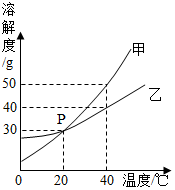
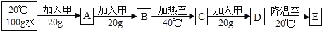

# Chemistry - 题目 164

**ID**: d933065606f1400dbb432a52fbb055e6
**年级**: Grade 9
**难度**: Medium-Hard
**题型**: Comprehensive

## 题目
（1）分析下表数据回答下列问题：温度/℃010203040506070KNO_{3}的溶解度/g13.320.93245.86485.5110138NaCl 的溶解度/g35.735.83636.336.63737.337.8①以上两种物质溶解度的变化受温度变化影响较小的是。​​​​​​​‌②NaCl 与 KNO_{3}具有相等溶解度的温度（t）范围是。③ 硝酸钾溶液中含有少量 NaCl 时，可通过的方法提取较纯 KNO_{3}。④ 对③析出的晶体和剩余溶液描述正确的有（填标号）。A 剩余溶液一定是 KNO_{3}饱和溶液B 剩余溶液一定是 NaCl 饱和溶液C 上述方法可以将两者完全分离D 析出的晶体中只含有 KNO_{3}（2）甲、乙两种固体物质的溶解度曲线如图所示。① 图中P 点的含义是。② 40℃时，饱和溶液中溶质的质量分数：甲（填“>” “=”或“<”） 乙。③20℃时，将 60 g 乙物质放入 100 g 水中，升温至 40℃，溶液中溶质与溶剂质量比为（填最简整数）。④20℃时，进行如下图所示的实验：上述实验过程中所得的溶液，属于不饱和溶液的有（填标号，下同）；溶液与 B 溶液中溶质的质量分数相同。

## 解答

1. （1）①从图表中可知，硝酸钾的溶解度变化受温度影响较大，氯化钠的溶解度变化受温度影响较小；故填：氯化钠；
2. ②由KNO_{3}与NaCl在不同温度时的溶解度可知，KNO_{3}和NaCl的溶解度相等的温度（t）范围是20-30℃；故填：20-30℃；
3. ③从表格中数据可知硝酸钾的溶解度随温度的降低而减小且受温度变化影响较大，但是氯化钠的溶解度受温度变化影响较小，所以KNO_{3}溶液中含有少量NaCl时，可通过降温结晶的方法提纯KNO_{3}；故填：降温结晶；
4. ④A、由于析出了硝酸钾晶体，说明该溶液是硝酸钾的饱和溶液，故说法正确；
5. B、降温析出的是硝酸钾，但是对于氯化钠来说不一定析出，所以得到溶液不一定是氯化钠的饱和溶液，故错误；
6. C、在析出硝酸钾的同时，也会有析出少量氯化钠，所以上述方法不可以将两者完全分离，故错误；
7. D、根据C中的解答可以知道，析出的晶体中可能含有氯化钠，故错误；
8. 故选：A；
9. （2）①通过分析溶解度曲线可知，图中P点的含义是：20℃时，甲、乙的溶解度均为30g；故填：20℃时，甲、乙的溶解度均为30g；
10. ②40℃时，甲物质的溶解度大于乙，所以饱和溶液中溶质的质量分数：甲＞乙；故填：＞；
11. ③20℃时，将60g乙物质放入100 g水中，升温至40℃，溶液中溶解的溶质与溶剂的质量比为40g：100g=2：5；故填：2：5；
12. ④20℃时，甲物质的溶解度是30g，40℃时，甲物质的溶解度是50g，进行了如图2所示的实验：上述实验过程中所得的溶液，属于不饱和溶液的是AC，E溶液与B溶液都是20℃时的饱和溶液，所以溶液中溶质的质量分数相同。故填：AC；E。

## 知识点

**中文**:
  - 影响溶解度的因素
  - 饱和溶液与不饱和溶液
  - 溶解度曲线

**English**:
  - Factors Affecting Solubility
  - Saturated and Unsaturated Solutions
  - Solubility Curve

---
