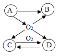

# Chemistry - 题目 198

**ID**: 9ea5ced57f974d9e8da20b5a5e4d192a
**年级**: Grade 9
**难度**: Medium-Hard
**题型**: Deduction

## 题目
A、B、C、D是初中化学常见的物质。​​​​​​​‌已知B是相对分子质量最小的氧化物，D是植物光合作用的原料之一。如图为它们之间的转化关系，请回答下列问题：（1）物质C的名称为；（2）A转化为B的化学方程式为；（3）D转化为C的化学方程式为。

## 解答

1. （1）由以上分析可知：物质C是一氧化碳；
2. 故填：一氧化碳。
3. （2）A转化为B是过氧化氢在二氧化锰做催化剂的条件下反应生成水和氧气，反应的化学方程式是 ${\rm{2}}{\rm{H}}_{{\rm{2}}}{\rm{O}}_{{\rm{2}}}\begin{array}{}{\underline{{\underline{{\rm{M}}{\rm{n}}{\rm{O}}_{{\rm{2}}}}}}}\\\;\end{array}{\rm{2}}{\rm{H}}_{{\rm{2}}}{\rm{O}}{\rm{+}}{\rm{O}}_{{\rm{2}}}\uparrow $ ；
4. 故填： ${\rm{2}}{\rm{H}}_{{\rm{2}}}{\rm{O}}_{{\rm{2}}}\begin{array}{}{\underline{{\underline{{\rm{M}}{\rm{n}}{\rm{O}}_{{\rm{2}}}}}}}\\\;\end{array}{\rm{2}}{\rm{H}}_{{\rm{2}}}{\rm{O}}{\rm{+}}{\rm{O}}_{{\rm{2}}}\uparrow $ 。
5. （3）D转化为C是二氧化碳转化为一氧化碳，也就是碳与二氧化碳在高温条件下反应生成一氧化碳，反应的化学方程式 ${\rm{C}}{\rm{+}}{\rm{C}}{\rm{O}}_{{\rm{2}}}\begin{array}{}{\underline{{\underline{高温}}}}\\\;\end{array}{\rm{2}}{\rm{C}}{\rm{O}}$ ；
6. 故填： ${\rm{C}}{\rm{+}}{\rm{C}}{\rm{O}}_{{\rm{2}}}\begin{array}{}{\underline{{\underline{高温}}}}\\\;\end{array}{\rm{2}}{\rm{C}}{\rm{O}}$ 。

## 知识点

**中文**:
  - 相对分子质量
  - 过氧化氢制取氧气
  - 碳单质和碳的氧化物的转化

**English**:
  - Relative Molecular Mass
  - Preparation of Oxygen using Hydrogen Peroxide
  - Transformation between Carbon Allotropes and Oxides

---
