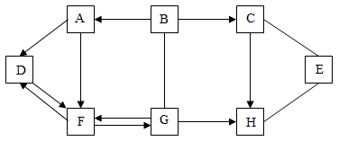

# Chemistry - 题目 236

**ID**: b72b3406e3cf4650906fc774fd579836
**年级**: Grade 9
**难度**: Medium-Hard
**题型**: Deduction

## 题目
已知A～H为初中化学常见物质。​​​​​​​‌其中A、B、F为不同状态的氧化物，B和H都为红色固体，各种物质间的部分转化关系如图所示（“—”表示相连的两物质可发生反应，“→”表示可以向箭头所指方向一步转化，反应条件、部分反应物和生成物已略去）。(1)请写出B的化学式。(2)请写出F→G的化学方程式。

## 解答

1. （1）由分析知，B是氧化铁，氧化铁的化学式是Fe_{2}O_{3}，故填：Fe_{2}O_{3}。
2. （2）由分析知，F为水，G为氢气，F→G的反应是水在通电的条件下分解生成氢气和氧气，反应的化学方程式为：，故填：。

## 知识点

**中文**:
  - 氢气的性质及纯度检验
  - 氧化物的判断
  - 碳单质和碳的氧化物的转化
  - 金属活动性顺序

**English**:
  - Properties and Purity Testing of Hydrogen
  - Identification of Oxides
  - Transformation between Carbon Allotropes and Oxides
  - Metal Activity Series

---
