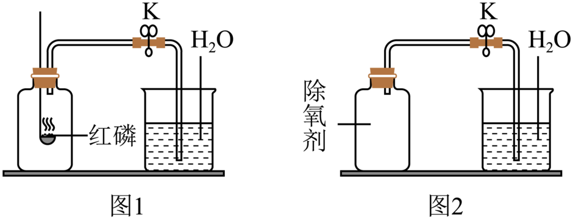
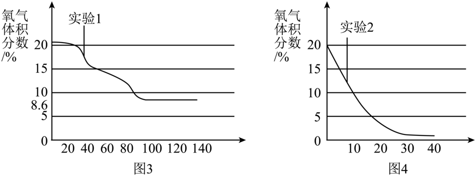
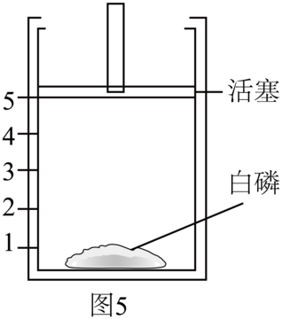

# Chemistry - 题目 20

**ID**: 2fa66d429109485db049c51b9052f616
**年级**: Grade 9
**难度**: Medium-Hard
**题型**: Experiment

## 题目
实验兴趣小组开展“测定密闭容器中氧气的体积分数”的探究实验。​​​​​​​‌【实验1】按图1所示装置，用红磷燃烧的方法测定空气中氧气的体积分数。【实验2】按图2所示装置，在集气瓶内壁用水均匀涂附铁粉除氧剂（其中辅助成分不干扰实验），利用铁锈蚀原理测定空气中氧气的体积分数。(1)实验1中，红磷燃烧的符号表达式为。红磷熄灭后，集气瓶冷却至室温打开K，水能倒吸入集气瓶，其原因是红磷燃烧消耗氧气，导致瓶内气压（填“变小”、“不变”或“变大”）。(2)实验过程中，连接数字传感器，测得实验1、实验2中氧气的体积分数随时间变化的关系分别如图3、图4所示。依据图3、图4信息，（填“实验1”或“实验2”）的测定方法更准确，判断依据。(3)根据图3所示，当反应停止并恢复至室温，集气瓶仍有8.6%左右的氧气，但实际实验中倒吸入瓶内的水的体积能达到理论值（五分之一），其可能的操作原因是。【实验3】兴趣小组设计了如图5的实验装置测定空气中氧气的体积分数，在一个耐热容器的底部放一块足量的白磷，然后迅速将活塞下压后放手，容器中的白磷开始燃烧。（白磷的体积忽略不计，白磷燃烧所需的最低温度为40℃）(4)检查装置气密性：向下压活塞，放手后活塞恢复到原位置，说明。(5)迅速下压活塞，白磷能被点燃的原因是。(6)白磷开始燃烧后，活塞的运动情况为，最后停在刻度处。

## 解答

1. （1）实验1中，红磷燃烧生成五氧化二磷，反应的符号表达式为P+O_{2}${\rm {\xrightarrow[~\;~]{~{点燃}~}}}$ P_{2}O_{5}。红磷熄灭后，集气瓶冷却至室温打开K，水能倒吸入集气瓶，其原因是红磷燃烧消耗氧气，导致瓶内气压变小；
2. （2）实验过程中，连接数字传感器，测得实验1、实验2中氧气的体积分数随时间变化的关系分别如图3、图4所示。依据图3、图4信息，实验2的测定方法更准确，判断依据，实验2反应结束后瓶内剩余氧更少，消耗氧气更充分；
3. （3）根据图3所示，当反应停止并恢复至室温，集气瓶仍有8.6%左右的氧气，但实际实验中倒吸入瓶内的水的体积能达到理论值（五分之一），即测量结果偏大，是由于反应结束后集气瓶内的气压偏小，可能是空气在实验过程中逸出，具体的原因可能是红磷点燃后放入集气瓶中的速度太慢或没有关闭弹簧夹等；
4. （4）检查装置气密性：向下压活塞，放手后活塞恢复到原位置，说明气体没有逸出，装置的气密性良好；
5. （5）迅速下压活塞，白磷能被点燃的原因是速下压活塞，使容器内空气的内能增大，温度升高至40℃以上，导致白磷燃烧；
6. （6）白磷开始燃烧后，气体膨胀，气压增大，反应后温度下降，气压降低，活塞的运动情况为先往上再往下；氧气体积约占空气体积的五分之一，最后停在刻度4处。

## 知识点

**中文**:
  - 测定空气中氧气含量的装置改进
  - 测定空气里氧气含量的探究

**English**:
  - Apparatus Improvement for Measuring Oxygen Content
  - Inquiry into Oxygen Content in Air

---
