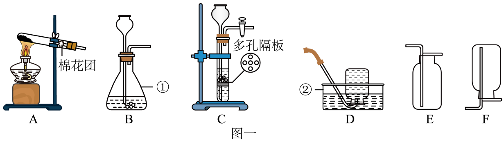
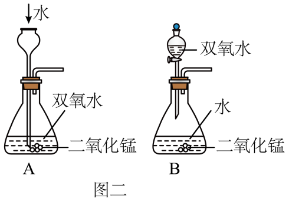
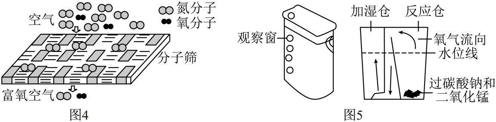

# Chemistry - 题目 159

**ID**: 6c9eff03ac164984875d6e7bb297efab
**年级**: Grade 9
**难度**: Medium-Hard
**题型**: Experiment

## 题目
氧气在生产、生活中有广泛应用，制取氧气的方法有多种。​​​​​​​‌【实验制O_{2}】如图为实验室制取气体的常见装置。请回答：(1)填写仪器名称，①是，②是。(2)实验室利用B装置制取氧气的化学方程式是；收集较纯净的氧气可选择的收集装置是（填字母），选择该收集方法利用了氧气的性质为：。(3)将二氧化锰粉末用纱布包起来，也可利用C装置制氧气，装置C的突出优点是。(4)拓展延伸：若直接用30%的H_{2}O_{2}溶液制取氧气，反应速率太快。为获得平稳的气流，图二中能达到最佳效果的是（填字母）。【家庭制O_{2}】随着科技的进步，家用制氧机逐步走进千家万户。(5)新型分子筛制氧机以空气为原料，将氧分子从空气中“筛”出去，从而获得高浓度的氧气，其原理如图4所示，该获得O_{2}的过程属于（填“物理”或“化学”）变化。(6)化学药剂型家用制氧机如图5，可利用过碳酸钠（ $2{\rm{N}}{\rm{a}}{{}_{2}}{\rm{C}}{\rm{O}}{{}_{3}}\cdot 3{\rm{H}}{{}_{2}}{\rm{O}}{{}_{2}}$ ，是一种白色固体，遇水分解为 ${\rm{N}}{\rm{a}}{{}_{2}}{\rm{C}}{\rm{O}}{{}_{3}}$ 和 ${\rm{H}}{{}_{2}}{\rm{O}}{{}_{2}}$ ， $2{\rm{N}}{\rm{a}}{{}_{2}}{\rm{C}}{\rm{O}}{{}_{3}}\cdot 3{\rm{H}}{{}_{2}}{\rm{O}}{{}_{2}}\hspace{-0.5em}\begin{array}{}{\underline{{\underline{~{\rm{M}}{\rm{n}}{\rm{O}}{{}_{2}}~}}}}\atop{}\end{array}\hspace{-0.5em}4{\rm{N}}{\rm{a}}{{}_{2}}{\rm{C}}{\rm{O}}{{}_{3}}+6{\rm{H}}{{}_{2}}{\rm{O}}+3{\rm{O}}{{}_{2}}\uparrow $ ）等试剂与水反应获取O_{2}。表中是该制氧机的用量说明（部分）。过碳酸钠二氧化锰平均供氧量（毫升/分钟）供养时间（分钟）配方一1袋1袋≥320≥15配方二2袋1袋≥500≥25配方三3袋2袋≥1000≥15①若突发缺氧性疾病，在呼叫救护的同时进行吸氧，应选择的最佳配方是。②用该制氧机制氧时，反应仓内有黑色粉末翻腾，变得浑浊，仓壁变得温热，过滤仓底部导气管有气泡冒出。过滤仓中的水除了有过滤杂质提纯氧气的作用外，还可以起到的作用是（填序号）。

## 解答

1. （1）仪器名称：①是锥形瓶；②是水槽；
2. （2）装置B是固体与液体混合不需加热的发生装置，制氧气所用药品是过氧化氢溶液和二氧化锰，过氧化氢在二氧化锰催化作用下分解生成水和氧气，反应的化学方程式为： ${{2}}{\rm{H}}{{}_{{{2}}}}{\rm{O}}{{}_{{{2}}}}\hspace{-0.5em}\begin{array}{}{\underline{{\underline{~{\rm{M}}{\rm{n}}{\rm{O}}{{}_{{{2}}}}~}}}}\atop{}\end{array}\hspace{-0.5em}{{2}}{\rm{H}}{{}_{{{2}}}}{\rm{O}}{{+}}{\rm{O}}{{}_{{{2}}}}\uparrow $ ；氧气密度略大于空气，不易溶于水，可用向上排空气法收集或排水法收集，用向排水法收集的气体较为纯净，收集较纯净的氧气可选择的收集装置是D；选择排水法收集氧气是利用了氧气不易溶于水且不与水反应的性质；
3. （3）装置C中，二氧化锰用纱布包起来放在多孔隔板上，过氧化氢溶液从长颈漏斗中加入，反应开始后，关闭开关时，试管中的气体增多，压强增大，把液体压入长颈漏斗，固体和液体分离，反应停止，打开开关时，气体导出，试管中的气体减少，压强减小，液体和固体混合，反应进行；装置C的突出优点是是可以控制反应的发生与停止；
4. （4）为获得平稳的气流，需要控制液体的滴加速度，A装置中长颈漏斗不能控制液体滴加速度；B 装置中分液漏斗可以控制液体滴加速度；能达到最佳效果的是B；
5. （5）新型分子筛制氧机以空气为原料，将氧分子从空气中 “筛” 出去，此过程中没有新物质生成，属于物理变化；
6. （6）①若突发缺氧性疾病，在呼叫救护的同时进行吸氧，需要短时间内获得大量氧气，根据表格数据，配方三平均供氧量≥1000毫升 / 分钟，能满足需求，所以应选择的最佳配方是配方三；
7. ②过滤仓中的水除了过滤杂质提纯氧气外，还可以通过观察气泡观察氧气生成的速率，同时可以降低氧气温度，而水不能加快氧气的生成。故选AB；
8. （7）甲装置产生的氧气，通过导管进入右瓶，可根据水中气泡产生的速率判定氧气的产生速率，无缺陷；
9. 乙装置中，右侧瓶中导管在液面以下，反应生成的氧气无法导出，该装置有缺陷，
10. 丙装置可通过注射器控制液体的滴加速率，从而控制氧气流量，无缺陷。
11. 故选乙；
12. （8）CaO_{2}与H_{2}O反应生成氧气的速率太慢，不能用于实验室制取O_{2}；二氧化碳能与澄清石灰水中的氢氧化钙反应生成碳酸钙沉淀和水，CaO_{2}与H_{2}O反应，另一种生成物常用于吸收二氧化碳，根据质量守恒定律和二氧化碳能与澄清石灰水中的氢氧化钙反应生成碳酸钙沉淀和水，可知另一种生成物是氢氧化钙，该反应的化学方程式为2CaO_{2}+2H_{2}O=2Ca(OH)_{2}+O_{2}↑。

## 知识点

**中文**:
  - 其他制取氧气的方法
  - 化学变化与物理变化
  - 装置的选用与安装
  - 氧气的物理性质
  - 过氧化氢制取氧气

**English**:
  - Other Methods for Preparing Oxygen
  - Chemical Changes vs. Physical Changes
  - Selection and Assembly of Apparatus
  - Physical Properties of Oxygen
  - Preparation of Oxygen using Hydrogen Peroxide

---
