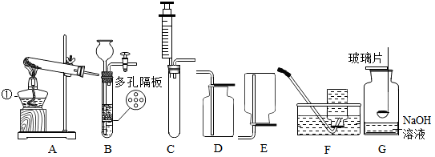
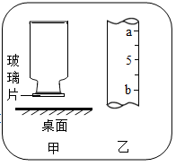

# Chemistry - 题目 43

**ID**: de55adb461ea4ba489352dc8e1445c32
**年级**: Grade 9
**难度**: Medium-Hard
**题型**: Experiment

## 题目
根据图回答问题(1)写出图中标号仪器名称：①。​​​​​​​‌(2)实验室用氯酸钾与二氧化锰混合加热制取氧气，应选用的发生装置是(填字母代号，下同)，若要收集较纯净的氧气，可选用的收集装置是，该反应的化学方程式为。(3)实验室可用氧化钙固体与浓氨水在常温下混合制取少量氨气，为了得到平稳的氨气流，应选择的发生装置是。(4)用G装置做硫在氧气中燃烧的实验时，用NaOH溶液来吸收生成的二氧化硫气体，持燃烧结束后迅速取出燃烧匙，立即用玻璃片盖住瓶口并振荡，若将集气瓶倒转，发现玻璃片被“吸住”而不掉下来(如甲图)，其原因是。(5)若用10mL量筒量取6mL氢氧化钠溶液，读数时量筒内的液体凹液面最低处应与乙图中处(填“a”或“b”)刻度线保持水平。

## 解答

1. （1）根据图可知该装置是酒精灯；
2. （2）实验室用氯酸钾制取氧气，发生装置属于“固体加热型”制气体，故选A，氧气密度比空气大、不易溶于水，可用向上排空气法或排水法收集，但收集纯净的氧气用排水法收集，收集装置是F；该反应的化学方程式为： $ {\rm{2}}{\rm{K}}{\rm{C}}{\rm{l}}{\rm{O}}_{{\rm{3}}}{\rm{=}}_{{\rm{Δ}}}^{{\rm{M}}{\rm{n}}{\rm{O}}_{{\rm{2}}}}{\rm{2}}{\rm{K}}{\rm{C}}{\rm{l}}{\rm{+}}{\rm{3}}{\rm{O}}_{{\rm{2}}}\uparrow $
3. （3）用氧化钙固体与浓氨水在常温下混合制取少量氨气，属于固液常温型，为了得到平稳的氨气流，应控制反应物的量或反应物的浓度，而C中的注射器可逐滴滴加液体，控制反应物的量，从而达到实验目的；
4. （4）玻璃片被“吸住”而不掉下来，其原因是：二氧化硫与氢氧化钠反应，导致集气瓶内的气压减小，外界大气压将玻璃片“托住”；
5. （5）量筒的示数是上大下小，所以读数时量筒内的液体凹液面最低处应与A图中a处的刻度线保持水平。

## 知识点

**中文**:
  - 基本实验仪器
  - 氯酸钾制取氧气

**English**:
  - Basic Experimental Instruments
  - Preparation of Oxygen using Potassium Chlorate

---
