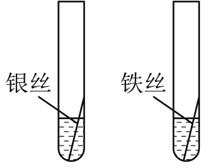

# Chemistry - 题目 115

**ID**: e7312867db354bd5a73f1ba970ba693f
**年级**: Grade 9
**难度**: Medium-Hard
**题型**: Experiment

## 题目
探秘古钱币。​​​​​​​‌古币金属知多少。我国古代的钱币有多种，如金币、银铜币、铁币等。金属性质共探究。小郑同学做了如下实验：(1)如图，两支试管里均为溶液，能比较铁、银和铜的金属活动性，发生反应的现象是。货币流通有原因。铁硬度比铜大，密度比铜小，金和银做成的钱币比铜币腐蚀速度要慢得多，似乎更适合铸造钱币，但是中国历史上铜币的使用量远大于其它材质的货币。(2)综上所述，古代铸造钱币选择金属考虑的因素是：①；②；③价格；④密度等。(3)铜币易产生铜绿，探究铜绿——碱式碳酸铜制备的最佳实验条件。碱式碳酸铜有多种组成，可表示为Cu(OH)_{x}(CO_{3})_{y}，x和y需满足的关系式为。【查阅资料】铜暴露在空气中产生铜绿。(4)①铜绿的化学性质与Cu(OH)_{2}和CuCO_{3}混合物的性质相似。依次写出铜制取氢氧化铜的化学方程式：；②铜绿是翠绿色、难溶于水的固体。【进行实验】(5)在一定温度下，将50mL8%的CuSO_{4}溶液缓慢加入到一定体积、5.3%的Na_{2}CO_{3}溶液中，充分反应后，经过过滤、洗涤、干燥得到一定量的固体。实验数据及实验现象如下：序号CuSO_{4}溶液体积/mLNa_{2}CO_{3}溶液体积/mL温度/°C反应后得到的固体颜色a506060蓝绿b50X70翠绿c506080暗绿d507070蓝绿e505070蓝绿①a、b、c的实验目的是。②根据实验数据规律，X的数值是。③用50g16%的CuSO_{4}溶液制备8%的CuSO_{4}溶液，需要加水g。

## 解答

1. （1）该实验的目的是比较铁、银和铜的金属活动性，故两支试管里可以均为硝酸铜溶液，银和硝酸铜不反应，无明显现象，说明铜比银活泼，铁与硝酸铜反应生成硝酸亚铁和铜，有红色固体析出，说明铁比铜活泼，可得出三种金属的活动性顺序为Fe＞Cu＞Ag；
2. 发生的反应为铁和硝酸铜反应生成硝酸亚铁和铜，现象是铁丝表面有红色固体析出，溶液由蓝色变为浅绿色；
3. （2）铁硬度比铜大，密度比铜小，中国历史上铜币的使用量远大于其它材质的货币，说明古代铸造钱币选择金属考虑硬度和密度；金和银做成的钱币比铜币腐蚀速度要慢得多，似乎更适合铸造钱币，说明古代铸造钱币选择金属需要考虑耐腐蚀性；
4. （3）Cu(OH)_{x}(CO_{3})_{y}中铜元素显+2价，氢氧根离子显-1价，碳酸根离子显-2价，根据化合物中，各元素正、负化合价的代数和为零，可得： $\left ({+2}\right )+\left ({-1}\right )\times x+\left ({-2}\right )\times y=0$ ，则x+2y=2；
5. （4）①铜能与氧气在加热的条件下反应生成氧化铜，该反应的化学方程式为 ${{2}}{\rm{C}}{\rm{u}}{{+}}{\rm{O}}{{}_{{{2}}}}\hspace{-0.5em}\begin{array}{}{\underline{\underline {{\rm{Δ}}}}}\\\;\end{array}\hspace{-0.5em}{{2}}{\rm{C}}{\rm{u}}{\rm{O}}$ ，氧化铜和硫酸反应生成硫酸铜和水，该反应的化学方程式为 ${\rm{C}}{\rm{u}}{\rm{O}}{{+}}{\rm{H}}{{}_{{{2}}}}{\rm{S}}{\rm{O}}{{}_{{{4}}}}{\rm{=}}{\rm{C}}{\rm{u}}{\rm{S}}{\rm{O}}{{}_{{{4}}}}{{+}}{\rm{H}}{{}_{{{2}}}}{\rm{O}}$ ，硫酸铜和氢氧化钠反应生成氢氧化铜和硫酸钠，该反应的化学方程式为 ${{2}}{\rm{N}}{\rm{a}}{\rm{O}}{\rm{H}}{{+}}{\rm{C}}{\rm{u}}{\rm{S}}{\rm{O}}{{}_{{{4}}}}{\rm{=}}{\rm{C}}{\rm{u}}{\rm{(}}{\rm{O}}{\rm{H}}{\rm{)}}{{}_{{{2}}}}\downarrow {{+}}{\rm{N}}{\rm{a}}{{}_{{{2}}}}{\rm{S}}{\rm{O}}{{}_{{{4}}}}$ ；
6. （5）①由表中数据可知，a、b、c中温度不同，硫酸铜溶液的体积相同，实验目的应是：探究相同条件下，温度对反应后得到的固体颜色的影响；
7. ②由①可知，实验a、b、c是探究相同条件下，温度对反应后得到的固体颜色的影响，故根据控制变量法，a、b、c实验中应温度不同，其它因素相同，故X的数值是60；
8. ③解：设需要加水的质量为x，根据稀释前后，溶质的质量不变，可得： $50{\rm{g}}\times 16\%=\left ({50{\rm{g}}+x}\right )\times 8\%{\rm ，\mathit{x}=50g}$ 。

## 知识点

**中文**:
  - 溶液稀释方法
  - 金属材料的应用
  - 金属活动性顺序
  - 金属活动性强弱的实验探究

**English**:
  - Methods of Dilution
  - Applications of Metal Materials
  - Metal Activity Series
  - Experimental Inquiry of Metal Activity Strength

---
