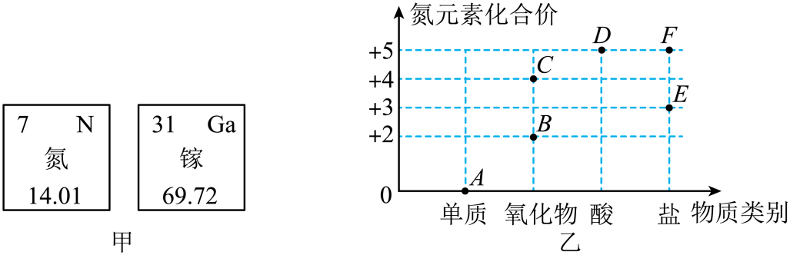
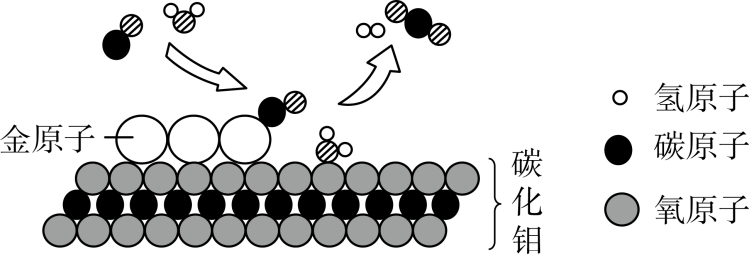

# Chemistry - 题目 259

**ID**: 082a8ad81e5b45138c9c1cc512a77ab2
**年级**: Grade 9
**难度**: Medium-Hard
**题型**: 填空与简答

## 题目
在“宏观—微观—符号”之间建立联系，是化学特有的思维方式。​​​​​​​‌(1)“芯片”是电子产品的核心部件，氮化镓是制造芯片的材料之一，如图甲所示为氮元素、镓元素在元素周期表的一部分。①图甲中69.72是稼元素的。② ${\rm{N}}{\rm{H}}{{}_{{{4}}}^{{{+}}}}$ 中N的化合价为。(2)氮及其化合物的“化合价—物质类别”关系如图乙所示若 ${\rm{D}}$ 点对应的酸为 ${\rm{H}}{\rm{N}}{\rm{O}}{{}_{3}}$ ， ${\rm{F}}$ 点对应的盐是 ${\rm{N}}{\rm{a}}{\rm{N}}{\rm{O}}{{}_{3}}$ ，则由 ${\rm{D}}$ 点物质通过中和反应转化为 ${\rm{F}}$ 点物质需要加入的物质是。该物质是由（填“分子”“原子”或“离子”）构成的。(3)我国科学家研究出碳化钼（ ${\rm{M}}{\rm{o}}{{}_{2}}{\rm{C}}$ ）负载金原子组成的高效催化体系，使 ${\rm{C}}{\rm{O}}$ 和 ${\rm{H}}{{}_{2}}{\rm{O}}$ 在120℃下发生反应，反应的微观模型如图甲所示。该反应过程中：①金原子对（填“ ${\rm{C}}{\rm{O}}$ ”或“ ${\rm{H}}{{}_{2}}{\rm{O}}$ ”）起吸附催化作用。②反应的化学方程式为。(4)守恒思想是化学中重要的学科思想，电荷守恒便是其中之一，电荷守恒是指溶液中所有的阳离子所带正电荷之和等于所有阴离子所带负电荷之和。现有一混合溶液，组成如下表所示：离子${\rm{N}}{\rm{a}}{^{+}}$${\rm{A}}{\rm{l}}{^{3+}}$${\rm{N}}{\rm{O}}{{}_{3}^{-}}$${\rm{S}}{\rm{O}}{{}_{4}^{2-}}$个数abcd则该混合液的电荷守恒可表示为（用a、b、c、d表示）

## 解答

1. （1）①在元素周期表的一格中，元素名称下方的数字表示相对原子质量，故69.72是稼元素的相对原子质量；
2. ② ${\rm{N}}{\rm{H}}{{}_{{{4}}}^{{{+}}}}$ 显+1价，其中H的化合价为+1，设N的化合价为x，x+（+1）×4=+1，x=-3；
3. （2）D点为N元素显+5价的酸，为硝酸（HNO_{3}），硝酸通过中和反应生成硝酸钠，故该物质是碱，且含有钠元素，则为氢氧化钠，氢氧化钠是由钠离子和氢氧根离子构成的，故填：氢氧化钠；离子；
4. （3）①由图可知，金原子对即一氧化碳有吸附催化作用；
5. ②反应为一氧化碳与水在120℃和催化剂的条件下生成氢气和二氧化碳，方程式为： $CO+{\rm{H}}{{}_{2}}{\rm{O}}\xlongequal[120℃]{催化剂}{\rm{H}}{{}_{2}}+CO{{}_{2}}$ ；
6. （4）a个Na^{+}带a个单位正电荷，b个Al^{3+}带3b个单位正电荷，c个 $NO{{}_{3}^{-}}$ 带c个单位负电荷，d个 $SO{{}_{4}^{2-}}$ 带2d个单位负电荷，根据电荷守恒即溶液中所有的阳离子所带正电荷之和等于所有阴离子所带负电荷之和，则该混合液的电荷守恒可表示为：a+3b=c+2d。

## 知识点

**中文**:
  - 化学与生产生活
  - 化学实验与科学探究
  - 物质构成的奥秘
  - 身边的化学物质
  - 理科综合与新情景试题

**English**:
  - Chemistry in Production and Life
  - Chemical Experiments and Scientific Inquiry
  - Mystery of Matter Composition
  - Chemistry in Our Surroundings
  - Comprehensive Science and New Scenario Questions

---
