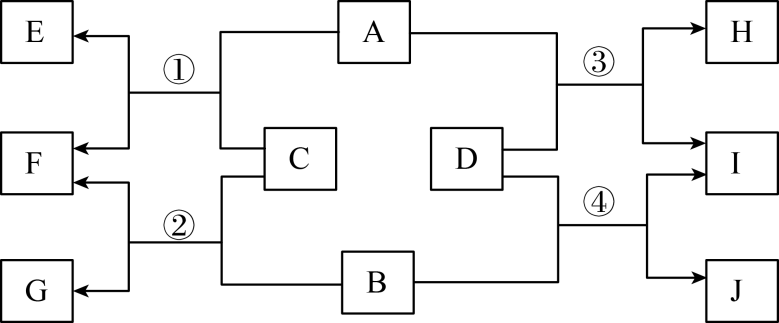

# Chemistry - 题目 69

**ID**: 224602c120c94107be99f3d56010301a
**年级**: Grade 9
**难度**: Medium-Hard
**题型**: 填空与简答

## 题目
A～J表示初中化学常见的物质，其中，B可用在铅酸蓄电池中、G是最清洁燃料、H是蓝色沉淀，各物质间相互转化关系如图所示。​​​​​​​‌请回答下列问题：（1）G的化学式为。（2）E的一种用途是。（3）反应④的基本反应类型为。（4）反应③的化学方程式为。

## 解答

1. 根据以上分析可知：
2. （1）G的化学式为H_{2}；
3. （2）E是铜，可用作做导线；
4. （3）反应④是硫酸与氢氧化钠反应生成硫酸钠和水，该反应是由两种化合物相互交换成分生成两种化合物的反应，基本反应类型为复分解反应；
5. （4）反应③是氢氧化钠与硫酸铜反应生成氢氧化铜沉淀和硫酸钠，反应的化学方程式为CuSO_{4 }+2NaOH=Na_{2}SO_{4 }+Cu（OH）_{2}↓。

## 知识点

**中文**:
  - 常见的复分解反应
  - 金属材料的应用
  - 硫酸的性质与用途

**English**:
  - Common Metathesis Reactions
  - Applications of Metal Materials
  - Properties and Uses of Sulfuric Acid

---
