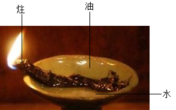

# Chemistry - 题目 350

**ID**: 267ecf7b726745db964e2ddbeef0a74b
**年级**: Grade 9
**难度**: Medium-Hard
**题型**: Fill-in-the-blank

## 题目
诗人陆游的笔记中记载“书灯勿用铜盏，想瓷盏最省油，蜀中有夹瓷盏…可省油之半”“一端作小窍，注清冷水于其中，每夕一易之”，夹瓷盏被称为省油灯，用棉绳做炷（灯芯），上层盏盛油，下层盏盛水。​​​​​​​‌其结构示意图如图。（1）图中属于可燃物的是和，这是燃烧的个条件之一。（2）省油灯的原理是：油燃烧，上层内盏油温，下层盏内水吸热，减少油的，以达到省油的目的。（3）“注清冷水于其中，每夕一易之”说明下层盏中的水不断减少。对该现象的微观解释正确的是（多选，填字母序号）。a．水分子受热分解       b．水分子不断运动c．水分子间隔变大       d．水分子数目减少

## 解答

1. （1）燃烧三要素：可燃物、氧气、温度达到着火点，图中属于可燃物的是炷和油，这是燃烧的三个条件之一，故填：炷；油；三。
2. （2）油燃烧放热，上层内盏油温升高，下层盏内水吸热，可以减少油的蒸发，以达到省油目的，故填：放热；升高；蒸发。
3. （3）下层盏中的水不断减少，是因为水受热，水分子间隔变大，水分子不断运动，运动加快，跑到了外界，故下层盏中的水不断减少，故选：bcd。

## 知识点

**中文**:
  - 燃烧条件与灭火原理探究

**English**:
  - Inquiry into Combustion Conditions and Extinguishing Principles

---
