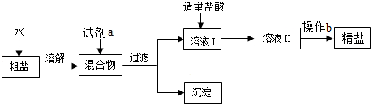

# Chemistry - 题目 252

**ID**: 1c00b1b40f61436badaa4a6527496503
**年级**: Grade 9
**难度**: Medium-Hard
**题型**: Multiple-choice

## 题目
粗盐中常含有MgCl_{2}、CaCl_{2}、Na_{2}SO_{4}及泥沙等杂质，常用下面的流程进行提纯。​​​​​​​‌下列说法正确的是（      ）

## 解答

1. A、提纯时先将粗盐溶于水形成溶液，镁离子用氢氧根离子沉淀，加入过量的氢氧化钠可以将镁离子沉淀，硫酸根离子用钡离子沉淀，加入过量的氯化钡可以将硫酸根离子沉淀，至于先除镁离子，还是先除硫酸根离子都行，钙离子用碳酸根离子沉淀，除钙离子加入碳酸钠转化为沉淀，但是加入的碳酸钠要放在加入的氯化钡之后，这样碳酸钠会除去反应剩余的氯化钡，离子都沉淀了，再进行过滤，最后再加入盐酸除去反应剩余的氢氧根离子和碳酸根离子，最后经蒸发操作得到较纯净的氯化钠，所以正确的顺序为氢氧化钠，氯化钡，碳酸钠，错误；
2. B、加入试剂a后，将混合物过滤，得到的沉淀中除泥沙外还含有4种不溶物，即氢氧化镁、硫酸钡、碳酸钙、碳酸钡，错误；
3. C、向溶液Ⅰ中加入的盐酸也可以是过量的，这是因为盐酸易挥发，随着蒸发氯化氢会挥发出去，正确；
4. D、操作b是将溶质与水分离，操作b的名称为蒸发，错误。
5. 故选：C。

## 知识点

**中文**:
  - 常见的复分解反应
  - 盐酸的性质与用途
  - 常见碱的性质与用途
  - 碳酸钠、碳酸氢钠和碳酸钙

**English**:
  - Common Metathesis Reactions
  - Properties and Uses of Hydrochloric Acid
  - Properties and Uses of Common Bases
  - Sodium Carbonate, Sodium Bicarbonate, and Calcium Carbonate

---
