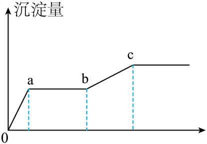

# Chemistry - 题目 250

**ID**: 266aae33b4154d20a47bcb4d24538872
**年级**: Grade 9
**难度**: Medium-Hard
**题型**: Multiple-choice

## 题目
某校化学兴趣小组按照下表所示进行了酸的化学性质探究实验。​​​​​​​‌实验后将试管A、B中的废液倒入废一只空烧杯中混合，没有明显现象；再将试管C中废液倒入烧杯中，发现产生沉淀，且产生沉淀的量与倒入溶液的量的关系如图所示。以下说法中，都不正确的是（      ）试管编号试管A试管B试管C所用试剂稀盐酸稀硫酸稀盐酸镁条碳酸钠氢氧化钡溶液①c点处溶液中的微粒只有Mg^{2+}和Cl^{﹣}^{ }②b→c时溶液的碱性逐渐增强③混合前试管A的废液中盐酸一定过量；④混合前试管B中废液的溶质可能没有H_{2}SO_{4}

## 解答

1. ①c点处随着加入的溶液C的量逐渐增加，沉淀的量保持不变则溶液中的Mg^{2+}均已转化为沉淀，c点处溶液中应当只有Na^{+}、Cl^{﹣}、Ba^{2+}，故①错误；
2. ②由分析可知，b→c时有反应 ${\rm{B}}{\rm{a}}{\rm{(}}{\rm{O}}{\rm{H}}{\rm{)}}{{}_{{{2}}}}+{\rm{M}}{\rm{g}}{\rm{C}}{\rm{l}}{{}_{{{2}}}}={\rm{M}}{\rm{g}}{\rm{(}}{\rm{O}}{\rm{H}}{\rm{)}}{{}_{{{2}}}}\downarrow +{\rm{B}}{\rm{a}}{\rm{C}}{\rm{l}}{{}_{{{2}}}}$ 发生，溶液碱性逐渐减弱，故②错误；
3. ③由图可知，ab段没有沉淀生成，所以有酸和试管C中过量的氢氧化钡反应，且没有沉淀生成，所以该酸不可能为硫酸，所以A中盐酸一定过量，故③正确；
4. ④如果试管B恰好反应完全，则试管B中只有Na_{2}SO_{4}，无H_{2}SO_{4}和Na_{2}CO_{3}，此时试管C中的氢氧化钡一开始依旧会与试管B中的硫酸钠反应生成沉淀，故④正确。
5. 综上所述，①②不正确，③④正确，故选A。

## 知识点

**中文**:
  - 酸的化学性质

**English**:
  - Chemical Properties of Acids

---
