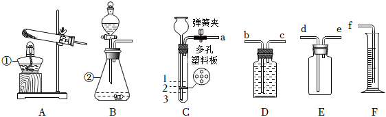

# Chemistry - 题目 230

**ID**: 3320a0b82b9e4c25af14df5f49663a92
**年级**: Grade 9
**难度**: Medium-Hard
**题型**: 非选择题（共40分）

## 题目
气体制取及性质验证是重要的化学实验活动，请结合下图装置，回答问题。​​​​​​​‌（1）写出以下仪器名称：①；②。（2）用锌粒与稀硫酸制取氢气时，使用装置C作发生装置。在反应过程中关闭弹簧夹，当反应停止时，液面应位于（填“1”、“2”、“3”）处。（3）要测量收集的氢气体积，应该把发生装置C的玻璃导管a与、与接口按顺序连接。（选填“b”、“c”、“d”、“e”、“f”）（4）为探究“向上排空气法”和“排水集气法”收集的氧气浓度是否有差异，吴同学做了如下实验：选用高锰酸钾制取氧气，待气流稳定后，分别用装置D和E各收集三瓶氧气，并用传感器测定集气瓶中的氧气浓度，测得数据见下表。收集方法排水集气法向上排空气法氧气浓度/%90.089.889.379.679.779.9氧气平均浓度/%89.779.7①用高锰酸钾制氧气时发生装置应选（填编号），理由是。②分析数据得出，以上两种方法中，法收集到的氧气更纯净。③用向上排空气法收集到的氧气浓度只有80%左右，以下分析正确的是。

## 解答

1. 解（1）仪器①是酒精灯，②是锥形瓶。
2. （2）关闭弹簧夹后，反应产生的氢气无法排出，装置内压强增大，会把稀硫酸压回长颈漏斗，使锌粒与稀硫酸分离，反应停止，此时液面应位于③处。因为随着压强增大，液体被挤压上升，直至多孔塑料板以下的液体被压回长颈漏斗。
3. （3）要测量收集的氢气体积，应采用排水法测量。将发生装置C的玻璃导管a与c接口连接，再将b接口与f接口相连。这样氢气进入集气瓶后，会将水从f口排出进入量筒，量筒内水的体积就是收集到的氢气体积。
4. （4）①用高锰酸钾制氧气时，反应物是固体，反应条件是加热，所以发生装置应选A。因为A装置适用于固体加热制取气体的反应。
5. ②分析数据可知，排水集气法收集的氧气平均浓度为89.7%，向上排空气法收集的氧气平均浓度为79.7%，排水集气法收集到的氧气浓度更高，所以排水集气法收集到的氧气更纯净。
6. ③A.氧气密度略大于空气，这使得用向上排空气法收集时，空气难以完全排尽，会残留部分空气，导致收集到的氧气浓度只有 80% 左右，故该选项正确；
7. B.加热高锰酸钾固体产生的氧气是纯净的，不是80%左右，故该选项错误；
8. C.当观察到带火星木条复燃时，只能说明集气瓶内氧气浓度达到了使木条复燃的程度，但集气瓶内还有空气，导致氧气浓度达不到100%，故该选项正确。
9. 故选：AC。

## 知识点

**中文**:
  - 多功能瓶的使用
  - 高锰酸钾制取氧气
  - 实验室制取氢气

**English**:
  - Use of Multi-functional Bottles
  - Preparation of Oxygen using Potassium Permanganate
  - Laboratory Preparation of Hydrogen

---
