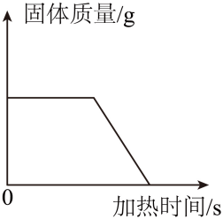
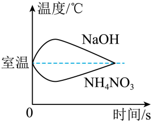

# Chemistry - 题目 306

**ID**: 4578f90ce85841798e982641a0a98d49
**年级**: Grade 9
**难度**: Medium-Hard
**题型**: Multiple-choice

## 题目
下列图像不能正确表示对应关系的是（      ）​​​​​​​‌

## 解答

1. A、加热碳和氧化铜的混合物，生成铜和二氧化碳，加热到一定温度，才能反应，随着反应的进行，二氧化碳逸出，属于固体的质量逐渐减少，至完全反应，不再发生改变，固体总质量不可能减少至0，该选项图像错误；
2. B、等量NaOH和NH_{4}NO_{3}固体分别溶于室温下足量的水中，氢氧化钠固体和硝酸铵固体溶于水分别放热、吸热，使温度分别升高、降低，一段时间后温度恢复至常温，该选项图像正确；
3. C、20℃时，向一定量不饱和的硝酸钾溶液中加入过量的硝酸钾晶体，硝酸钾晶体不断溶解，溶液的溶质质量分数变大；至达到饱和，硝酸钾不再溶解，溶液的溶质质量分数也不再改变，该选项图像正确；
4. D、向一定量稀盐酸和氯化钙的混合溶液中滴加碳酸钠溶液，盐酸优先和碳酸钠溶液反应生成氯化钠、水和二氧化碳，盐酸反应完全，碳酸钠与氯化钙溶液反应生成碳酸钙沉淀和氯化钠，氯化钙反应结束，继续滴加碳酸钠溶液，沉淀质量不变，该选项图像正确。
5. 故选A。

## 知识点

**中文**:
  - 溶解时的热量变化
  - 质量守恒定律的内容与应用

**English**:
  - Heat Changes during Dissolution
  - Content and Application of Law of Conservation of Mass

---
