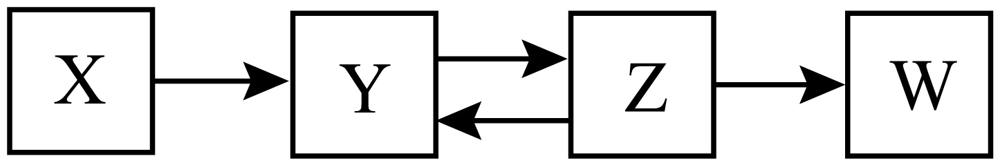

# Chemistry - 题目 224

**ID**: 4d8dc3c039064863b5759ec3c8c7784b
**年级**: Grade 9
**难度**: Medium-Hard
**题型**: Multiple-choice

## 题目
X、Y、Z、W四种物质的转化关系如图所示(“→”表示反应一步实现，部分物质和反应条件已略去)，则下列不符合转化关系的是选项XYZWAAlCuCuO_{CuCl2}B_{Fe2O3}_{FeCl3}_{Fe(OH)3}FeC_{H2O2}_{O2}_{H2O}_{H2CO3}DHCl_{CO2}_{Na2CO3}NaOH​​​​​​​‌

## 解答

1. A.铝可以与铜的化合物发生置换反应，置换出单质铜，铜在氧气中加热，生成氧化铜，氧化铜在碳、一氧化碳或者氢气的作用下还原得到单质铜，氧化铜与稀盐酸反应生成氯化铜，选项符合转化关系；
2. B.氧化铁与盐酸反应生成氯化铁，氯化铁与氢氧化钠反应生成氢氧化铁，氢氧化铁与稀盐酸反应生成氯化铁，但是氢氧化铁不能转化成单质铁，选项不符合转化关系；
3. C.过氧化氢在二氧化锰的催化作用下，分解生成氧气，氧气在氢气中燃烧生成水，水通电分解生成氧气，水与二氧化碳反应生成碳酸，选项符合转化关系；
4. D.盐酸与碳酸钙反应可以生成二氧化碳，二氧化碳与氢氧化钠反应生成碳酸钠，碳酸钠与酸反应生成二氧化碳，碳酸钠与氢氧化钙生成氢氧化钠，选项符合转化关系。
5. 故选B。

## 知识点

**中文**:
  - 过氧化氢制取氧气
  - 金属活动性顺序
  - 酸的化学性质

**English**:
  - Preparation of Oxygen using Hydrogen Peroxide
  - Metal Activity Series
  - Chemical Properties of Acids

---
