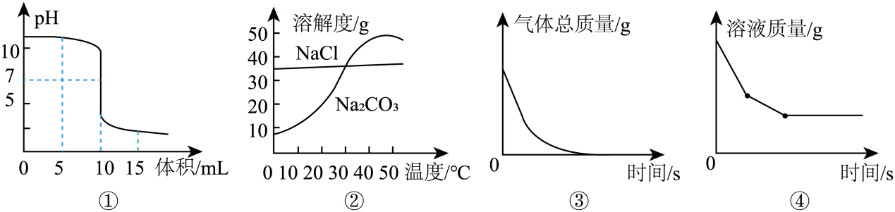

# Chemistry - 题目 227

**ID**: 5111926f5b174927abff24b9c80a7b96
**年级**: Grade 9
**难度**: Medium-Hard
**题型**: Multiple-choice

## 题目
下列根据图像提供的信息分析不正确的是（      ）​​​​​​​‌

## 解答

1. A、pH一开始大于7，最后小于7，故为将稀盐酸逐滴加入氢氧化钠溶液中所得溶液pH的变化，正确；
2. B、氯化钠溶解度受温度影响小，故采取蒸发结晶方式获得，即为夏季晒盐，碳酸钠溶解度受温度影响大，故采取降温结晶的方法获得，即为冬季捞碱，正确；
3. C、红磷在密闭容器中燃烧，消耗氧气，但是装置内还剩余氮气等，气体质量不会为0，错误；
4. D、将铁粉加入硝酸铜和硝酸银的混合溶液中，铁先与硝酸银反应，硝酸银完全反应后，铁再与硝酸铜反应，反应的铁与生成的银、铜质量关系如下：  $\hspace{-0.5em}\begin{array}{}{\rm{F}}{\rm{e}}&{{+}}&{{2}}{\rm{A}}{\rm{g}}{\rm{N}}{\rm{O}}{{}_{{{3}}}}&\hspace{-0.5em}\begin{array}{}{\underline{{\underline{~{\,}{\,}{\,}{\,}{\,}{\,}~}}}}\atop{}\end{array}\hspace{-0.5em}&{\rm{F}}{\rm{e}}\left ({{\rm{N}}{\rm{O}}{{}_{{{3}}}}}\right ){{}_{{{2}}}}&{{+}}&{{2}}{\rm{A}}{\rm{g}}\\{{5}}{{6}}&\;&\;&\;&\;&\;&{{2}}{{1}}{{6}}\end{array}\hspace{-0.5em}$ ， $\hspace{-0.5em}\begin{array}{}{\rm{F}}{\rm{e}}&{{+}}&{\rm{C}}{\rm{u}}\left ({{\rm{N}}{\rm{O}}{{}_{{{3}}}}}\right ){{}_{{{2}}}}&\hspace{-0.5em}\begin{array}{}{\underline{{\underline{~{\,}{\,}{\,}{\,}{\,}{\,}~}}}}\atop{}\end{array}\hspace{-0.5em}&{\rm{F}}{\rm{e}}\left ({{\rm{N}}{\rm{O}}{{}_{{{3}}}}}\right ){{}_{{{2}}}}&{{+}}&{\rm{C}}{\rm{u}}\\{{5}}{{6}}&\;&\;&\;&\;&\;&{{6}}{{4}}\end{array}\hspace{-0.5em}$ ，由反应的质量关系可以得出，等量的铁与硝酸银溶液反应析出的固体的质量比与硝酸铜溶液反应析出的固体质量大，即前者反应溶液质量减少的变化趋势明显，后者较前者缓慢，正确。
5. 故选：C。

## 知识点

**中文**:
  - 常见盐的用途
  - 测定空气中氧气含量
  - 盐的化学性质
  - 溶液的酸碱性与pH

**English**:
  - Uses of Common Salts
  - Measuring Oxygen Content in Air
  - Chemical Properties of Salts
  - Acidity/Basicity of Solutions and pH

---
