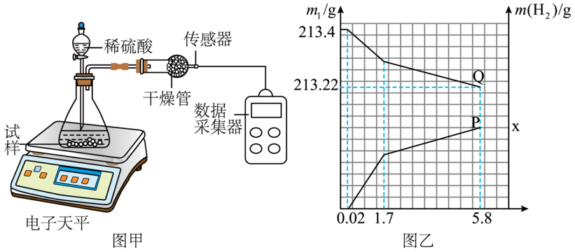

# Chemistry - 题目 25

**ID**: c108bb2a1b0f43539a93acedac90d6fb
**年级**: Grade 9
**难度**: Medium-Hard
**题型**: Multiple-choice

## 题目
订书钉主要成分是铁，其表面镀有镁或锌中的一种。​​​​​​​‌小组同学取订书钉5.6g放入图甲装置，并在干燥管口用氢气传感器测量氢气的质量，同时记录电子天平显示的质量变化（如图乙所示），5.8min后各数据保持稳定不再变化。下列说法不正确的是

## 解答

1. A、随着反应的进行，不断生成氢气，氢气不断逸出，锥形瓶中物质的质量逐渐减少，电子天平的读数减小，所以曲线Q表示电子天平读数，选项正确；
2. B、实验中应加入足量的稀硫酸，使金属完全反应，从而计算出另一种金属的成分，选项正确；
3. C、镁或锌的金属活动性比铁强，与酸的反应速率比铁快，由图可知，1.7min后金属与酸反应的速率减慢，即镁或锌与酸完全反应，1.7min后铁和硫酸开始反应，选项正确；
4. D、由图可知，5.6g金属完全反应后生成氢气的质量=213.4g−213.22g=0.18g，铁与硫酸反应的化学方程式为：Fe+H_{2}SO_{4}=FeSO_{4}+H_{2}↑，反应中铁与氢气的质量比为56：2，则5.6g铁与酸完全反应生成氢气的质量为0.2g，镁与硫酸反应的化学方程式为：Mg+H_{2}SO_{4}=MgSO_{4}+H_{2}↑，反应中镁与氢气的质量比为24：2，则5.6g镁与酸完全反应生成氢气的质量大于0.2g，锌与硫酸反应的化学方程式为：Zn+H_{2}SO_{4}=ZnSO_{4}+H_{2}↑，反应中锌与氢气的质量比为65：2，则5.6g锌与酸完全反应生成氢气的质量小于0.2g，由上述数据可知，订书钉表面镀的金属是锌，选项错误，故选D。

## 知识点

**中文**:
  - 金属与酸反应

**English**:
  - Reaction of Metals with Acids

---
