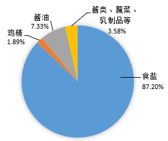
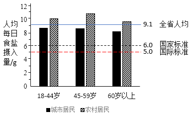

# Chemistry - 题目 218

**ID**: d400000f6619425889e53507f33d021e
**年级**: Grade 9
**难度**: Medium-Hard
**题型**: Science Reading

## 题目
在人体中，钠元素有重要的生理功能：调节水量、维持酸碱平衡、维持血压等。​​​​​​​‌我国居民膳食中每日通过食品或调料获得钠元素的主要来源如图所示。如图为2015年我国某省份人均每日食盐摄入量与国家推荐标准和世界卫生组织（WHO）推荐的国际标准的比对。事实证明，中国人的膳食结构中钠元素过多，钾元素过少，这样的情况易导致高血压的发生。为此，以碘盐为基础，加入有咸味的氯化钾，用氯化钾代替部分氯化钠（减钠增钾），使钠、钾比例合理，形成低钠盐。低钠盐有利于防治高血压，通常属于推荐用盐。但高温作业者、重体力劳动强度的工作人员（汗液流失会带走大量钠离子）、肾脏病或高钾血症患者不建议选用。北京超市中常见的深井岩盐和低钠岩盐成分配料表种类NaCl（g/100 g）KCl（g/100 g）KIO_{3}（以I计）（mg/kg）K_{4}Fe(CN)_{6}（以［Fe(CN)_{6}］^{4-}计）（mg/kg）深井岩盐≥98.5018~33≤10低钠岩盐65~8020~3518~33≤10依据文章内容回答下列问题。（1）由图可知，人们获得钠元素的主要来源是。（2）食盐中K_{4}Fe(CN)_{6}的主要作用是抗结剂，K_{4}Fe(CN)_{6}是由种元素组成的。（3）由图可知，下列说法不正确的是（填字母序号）。A 该省份人均每日摄入食盐的量超过了国家推荐的标准B 我国对食盐摄入量的推荐标准高于世界卫生组织（WHO）推荐的国际标准C 无论是城市居民还是农村居民，都是年龄越大，人均每日摄入食盐越少D 在图示的每个年龄段中，农村居民的人均每日食盐摄入量都比城市居民多（4）低钠盐既保证了调味需求，还有利于防治高血压，原因是。（5）依据表格，你建议外卖小哥在炎热的夏天选用的盐是。

## 解答

1. （1）从我国居民膳食中每日通过食品或调料获得钠元素的主要来源图可知，87.20%来源于食盐，7.33%来源于酱油，3.58%来源于酱类、腌菜、乳制品等，1.89%来源于味精，因此钠元素的主要来源是食盐，故填：食盐。
2. （2）K_{4}Fe(CN)_{6}由钾元素、铁元素、碳元素、氮元素共四种元素组成，故填：四。
3. （3）A、从该省份2015年人均每日食盐摄入量与国家推荐标准和世界卫生组织推荐的国际标准的比对图可以看出全省人均每日食盐摄入量是9.1g，超过国家推荐的标准6.0g，选项A不符合题意；
4. B、从图中可知我国推荐的标准是人均每日食盐摄入量6.0g，世界卫生组织推荐的国际标准是人均每日食盐摄入量是5.0g，因此我国对食盐摄入量的推荐标准高于世界卫生组织（WHO）推荐的国际标准，选项B不符合题意；
5. C、从图中可知，农村居民45-49岁阶段人均每日摄入量大于18-44岁阶段，因此不是年龄越大摄入量越少，选项C符合题意；
6. D、从图中可看出图示的每个年龄段中，农村居民的人均每日食盐摄入量都高于城市居民，选项D不符合题意。故选：C。
7. （4）中国人的膳食结构中钠元素过多，钾元素过少，这样的情况易导致高血压的发生，低钠盐中加入有咸味的氯化钾，用氯化钾代替部分氯化钠，使钠、钾比例合理，有利于防治高血压。故填：加入氯化钾代替部分氯化钠，氯化钾有咸味；且可达到减钠增钾的效果。
8. （5）外卖小哥在炎热的夏天工作，属于高温作业者，汗液流失会带走大量钠离子，需要补充钠离子，因此应选用深井岩盐，故填：深井岩盐。

## 知识点

**中文**:
  - 元素、原子与物质的联系
  - 常量元素、微量元素及其作用
  - 科普阅读

**English**:
  - Connection between Elements, Atoms, and Matter
  - Macroelements, Trace Elements and their Functions
  - Popular Science Reading

---
