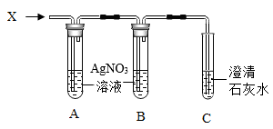

# Chemistry - 题目 280

**ID**: 0665a525134f4909b3378a436a10aac8
**年级**: Grade 9
**难度**: Medium-Hard
**题型**: Scientific Inquiry

## 题目
某化学兴趣小组想检验二氧化碳能与澄清的石灰水反应，用未知浓度的盐酸和碳酸钙反应，将制得的气体通入澄清石灰水中，始终没有发现石灰水变浑浊。​​​​​​​‌针对此现象，同学们展开了如下探究：〖提出问题〗澄清石灰水未变浑浊的原因是什么？〖作出猜想〗澄清石灰水未变浑浊的原因：甲同学的猜想：澄清石灰水已变质。乙同学的猜想：气体X中除了有CO_{2}外，还有（填化学式）气体杂质。〖实验探究〗同学们经过讨论后设计了如图所示实验装置进行探究。A、B试管中是AgNO_{3}溶液，C试管中是澄清石灰水，连接好装置后通入气体X（注：装置气密性良好）。①A试管中的AgNO_{3}溶液不用NaHCO_{3}溶液代替，原因是：。②盛有AgNO_{3}溶液的B装置的作用是。③若A、B、C试管中的现象分别是，则甲、乙同学的猜想都正确。〖实验反思〗检验物质的性质时，最好用纯物质，否则，若其他杂质对该物质的性质检验造成干扰，则应先排除干扰，再进行检验。〖实验拓展〗①若想检验二氧化碳能与澄清的石灰水反应，最好用碳酸钠溶液和制取二氧化碳，再将产生的气体通入新制的澄清的石灰水中，观察现象。②若某钠盐溶液中可能存在Na_{2}CO_{3}、NaCl的一种或两种溶质，请你描述检验这两种溶质的操作方法（已知：Ag_{2}SO_{4}、Ag_{2}CO_{3}均为白色难溶于水的沉淀）。

## 解答

1. 作出猜想：
2. 因为盐酸具有挥发性，则气体X中除了有CO_{2}外，还有HCl气体杂质，HCl气体溶于水和氢氧化钙反应生成氯化钙和水，导致石灰水不变浑浊；
3. 实验探究：
4. ①A试管中的AgNO_{3}溶液作用是检验并吸收HCl气体，若用NaHCO_{3}溶液代替，NaHCO_{3}溶液与HCl反应会生成二氧化碳，有气泡产生，但气体通入A试管溶液中出现的气泡对HCl与NaHCO_{3}溶液反应产生气泡会造成干扰，故不能用NaHCO_{3}溶液；
5. ②HCl溶于水与硝酸银溶液反应生成白色氯化银沉淀，故盛有AgNO_{3}溶液的A装置的作用是检验并吸收HCl气体，盛有AgNO_{3}溶液的B装置的作用是验证HCl是否除尽，防止HCl干扰后面的实验；
6. ③若甲、乙同学的猜想都正确，则气体X中含有CO_{2}和HCl，此时A中的现象为产生白色沉淀，说明气体中含有HCl，B中无沉淀产生，说明HCl气体已被完全吸收，C中澄清石灰水不变浑浊，说明澄清石灰水已变质；故填：A中有白色沉淀产生，B中无明显现象，C中无明显现象。
7. 实验拓展：
8. ①若想检验二氧化碳能与澄清的石灰水反应，最好用碳酸钠溶液和稀硫酸制取二氧化碳，稀硫酸没有挥发性，可避免盐酸挥发出的HCl气体影响实验结果；
9. ②碳酸钠能与酸反应生成二氧化碳气体，检验碳酸钠可以加酸，NaCl能与硝酸银反应生成氯化银沉淀，检验NaCl可以用AgNO_{3}溶液，因为Ag_{2}SO_{4}、Ag_{2}CO_{3}均为白色难溶于水的沉淀，为排除 $SO_{4}^{2-}$ 、 $CO_{3}^{2-}$ 、Cl^{-}对NaCl的检验造成干扰，检验Na_{2}CO_{3}应选用稀硝酸，操作方法是：取样，往溶液中加入足量稀硝酸，产生气泡，再往溶液中加入少量AgNO_{3}溶液，产生白色沉淀，则该钠盐溶液中含有Na_{2}CO_{3}、NaCl两种溶质。

## 知识点

**中文**:
  - 药品是否变质的探究

**English**:
  - Inquiry into Deterioration of Reagents

---
