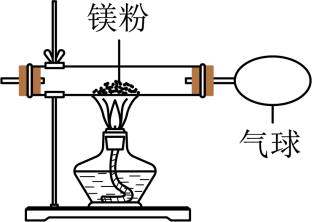

# Chemistry - 题目 41

**ID**: 0c4e3dd852314bc89e0367c512a977af
**年级**: Grade 9
**难度**: Medium-Hard
**题型**: Scientific Inquiry

## 题目
化学兴趣小组为验证质量守恒定律，做了镁条在空气中燃烧的实验（如右图）。​​​​​​​‌同学们观察到镁条在空气中剧烈燃烧，发出耀眼的强光，产生的大量白烟弥漫到空气中，最后在石棉网上得到一些白色固体。（1）请写出镁条燃烧的化学方程式。（2）同学们通过称量发现：在石棉网上收集到产物的质量小于镁条的质量。有人认为这个反应不遵循质量守恒定律。你认为出现这样实验结果的原因可能是：。（3）小红按右下图装置改进实验，验证了质量守恒定律，还发现产物中有少量黄色固体。【提出问题】黄色固体是什么？【查阅资料】①氧化镁为白色固体；②镁能与氮气剧烈反应生成黄色的氮化镁(Mg_{3}N_{2})固体；③氮化镁可与水剧烈反应产生氨气，该气体能使湿润的红色石蕊试纸变蓝。【做出猜想】黄色固体是Mg_{3}N_{2}【实验探究】请设计实验，验证猜想实验操作实验现象及结论【反思与交流】①氮化镁中氮元素的化合价是；②空气中N_{2}的含量远大于O_{2}的含量，可是镁条在空气中燃烧产物MgO却远多于Mg_{3}N_{2}，合理的解释是：；③同学们又联想到氢气在氯气中能够燃烧，于是对燃烧条件又有了新的认识：。

## 解答

1. （1）镁条燃烧的化学方程式为：2Mg+O_{2}$\hspace{-0.5em}\begin{array}{}{\underline{{\underline{~~点燃~~}}}}\atop{}\end{array}\hspace{-0.5em}$ 2MgO
2. （2）镁条燃烧后收集到的产物质量小于镁条的质量，出现这样实验结果的原因可能是：大量的白烟弥漫到空气中，使得生成物收集不全。
3. （3）[实验探究]将收集的产物中的黄色固体放入试管中，加入适量的水，在试管口放置湿润的红色石蕊试纸；有刺激性气味的气体生成，试纸由红色变蓝色；得到结论：黄色固体是Mg_{3}N_{2。}
4. [反思与交流]①化合物各元素化合价的代数和为零。②氮气化学性质不如氧气活泼。③燃烧不一定需要有氧气参加。

## 知识点

**中文**:
  - 质量守恒定律的实验探究
  - 镁在氧气中的燃烧及其实验

**English**:
  - Experimental Inquiry of Law of Conservation of Mass
  - Combustion of Magnesium in Oxygen and Experiment

---
