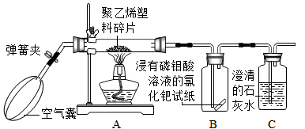

# Chemistry - 题目 269

**ID**: 0de9e28abf924e6d8ec21ceb45cfed2b
**年级**: Grade 9
**难度**: Medium-Hard
**题型**: Scientific Inquiry

## 题目
在化学的学习中，同学们知道：聚乙烯塑料只含C、H两种元素，如用焚烧方法处理废弃塑料会造成大气污染。​​​​​​​‌化学小组对聚乙烯塑料在空气中燃烧生成的碳的氧化物进行探究（提出猜想）A 只有CO_{2}B 只有COC 既有CO_{2}也有CO（查阅资料）微量CO遇到浸有磷钼酸溶液的氯化钯黄色试纸，立即变蓝；CO_{2}遇试纸不变色。（设计方案）化学兴趣小组在老师的指导下，设计下图所示实验，通过观察装置B、装置C的实验现象，验证猜想。实验步骤实验现象实验结论及化学方程式点燃酒精灯加热，随即打开弹簧夹，通入干燥的空气。观察装置B、装置C中的现象。装置B中的现象是：装置C中的现象是：聚乙烯塑料在空气中燃烧，生成碳的氧化物中，既有CO_{2}，也有CO。装置C中反应的化学方程式为：。（实验探究）请你帮助他们写成实验报告。（讨论）根据实验结论，从环保角度考虑，实验中应对尾气进行处理。处理方法是在实验装置的尾部加酒精灯将气体点燃，该处理方法利用的是CO的性；聚乙烯塑料在空气中燃烧，生成物中除了CO_{2}、CO外，还有另外一种氧化物，该物质为。

## 解答

1. 设计方案：如生成物中既有一氧化碳，又有二氧化碳，则浸有磷钼酸溶液的氯化钯黄色试纸立即变蓝，澄清的石灰水变浑浊。C中是氢氧化钙和二氧化碳反应生成碳酸钙沉淀和水，方程式为：Ca（OH）_{2}+CO_{2}═CaCO_{3}↓+H_{2}O。
2. 讨论：一氧化碳可以被点燃说明具有可燃性。聚乙烯塑料含C、H两种元素，根据质量守恒定律，燃烧时可生成碳的氧化物和水。

## 知识点

**中文**:
  - 一氧化碳与二氧化碳分离和鉴别
  - 实验探究物质的组成成分以及含量

**English**:
  - Separation and Identification of CO and CO2
  - Inquiry into Composition and Content of Matter

---
