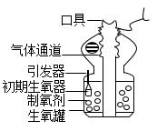
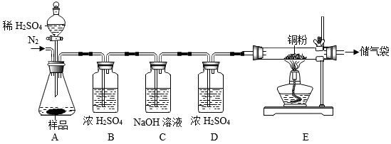

# Chemistry - 题目 54

**ID**: 69cbb7e7c399465e91b023771101ca84
**年级**: Grade 9
**难度**: Medium-Hard
**题型**: Scientific Inquiry

## 题目
呼吸自救器是人在缺氧环境或出现高浓度有毒有害气体环境中使用的一种安全防护装置。​​​​​​​‌如图是某化学氧自救器的示意图，其供氧装置由“初期生氧器”和“生氧罐”组成同学们对其工作原理进行了如下探究：Ⅰ.探究“初期生氧器”〖查阅资料1〗①该化学氧自数器在工作初期，内部独立的“初期生氧器”首先启动，以解决初期供氧不足的问题。“初期生氧器”内有氯酸钾、二氧化锰、铁粉等成分。②Fe_{3}O_{4}能与硫酸反应，其化学反应方程式为：Fe_{3}O_{4}+4H_{2}SO_{4}=Fe_{2}(SO_{4})_{3}+FeSO_{4}+4H_{2}O（1）“初期生氧器”主要依靠氯酸钾和二氧化锰制氧，其化学反应方程式为。（2）小组成员为了解铁粉的作用展开了研究。〖实验探究1〗序号实验步骤实验现象实验结论①取“初生氧器”充分反应后的物质于纸上，将磁铁靠近并接触粉末有黑色物质被磁铁吸引被吸引物质可能是Fe、Fe_{3}O_{4}或两者都有②取①中被铁吸引的物质于试管中，向其中加入足量稀硫酸固体完全溶解，得到澄清的黄色溶液被吸引物质中一定含有(填化学式)（3）“初期生氧器”中铁粉与氧气反应能，从而使氯酸钾的分解反应能持续进行。Ⅱ.探究“生氧罐”〖查阅资料2〗①该化学氧自救器主体是由“生氧罐”供氧，内部装有颗粒状超氧化钾作为“制氧剂”，其反应原理为：4KO_{2}+2H_{2}O=4KOH+3O_{2}↑；4KO_{2}+2CO_{2}=2K_{2}CO_{3}+3O_{2}②超氧化钾能与硫酸反应，其化学反应方程式为：4KO_{2}+2H_{2}SO_{4}=2K_{2}SO_{4}+3O_{2}↑+2H_{2}O〖实验探究2〗同学们对超氧化钾是否变质展开了研究，取出久置的“生氧罐”内颗粒状固体，称得样品质量为69.3g，进行如图所示实验，待实验结束测得C装置增重2.2g，E装置内固体变黒色且增重19.2g(实验前已排尽装置内空气，使用的药品均足量)（1）反应开始后A装置中通入N_{2}的目的是。（2）E装置中发生反应的化学反应方程式为。（3）超氧化钾(选填“未”“部分”或“全部”)变质。（4）生产该“生氧罐”时加入的超氧化钾的质量为克。

## 解答

1. Ⅰ.探究“初期生氧器”：
2. （1）氯酸钾和二氧化锰制氧的化学方程式是2KClO_{3}$\begin{array}{}{\underline{{\underline{{\rm{M}}{\rm{n}}{\rm{O}}_{{\rm{2}}}}}}}\\\Delta \end{array}$ 2KCl+3O_{2}↑。
3. （2）加入足量稀硫酸得到澄清的黄色溶液，说明反应后溶液中有Fe^{3+},所以被吸引物质中一定含有Fe_{3}O_{4}。
4. （3）因为氯酸钾的分解反应需要吸热，所以铁粉与氧气反应能放出大量的热才能维持氯酸钾的分解反应持续进行。
5. Ⅱ.探究“生氧罐”：
6. （1）反应开始后A装置中通入N_{2}的目的是将产生的CO_{2}和O_{2}排入后续的反应装置中参与反应，使实验测量结果更准确。
7. （2）铜在加热条件下可以和氧气发生反应生成氧化铜，所以E装置中发生反应的化学反应方程式为2Cu+O_{2}$\begin{array}{}{\underline{{\underline{Δ}}}}\\\;\end{array}$ 2CuO。
8. （3）因为C装置增重2.2g说明有二氧化碳生成。所取样品中含有碳酸钾。E装置内固体变黒色且增重19.2g说明有超氧化钾发生反应生成氧气，所以超氧化钾部分变质。
9. （4）E装置内固体变黒色且增重19.2g，说明生产氧气19.2g根据4KO_{2}+2H_{2}SO_{4}=2K_{2}SO_{4}+3O_{2}↑+2H_{2}O，设参与该反应的KO_{2}的质量为x，KO_{2}与生成的氧气的质量关系为
10. $\begin{array}{}{\rm{4}}{\rm{K}}{\rm{O}}_{2}\\284\\x\end{array}\begin{array}{}{\rm{\sim }}\\\\\;\end{array}\begin{array}{}3{\rm{O}}_{2}\\96\\19.2{\rm{g}}\end{array}\\\frac {284}{96}=\frac {x}{19.2{\rm{g}}}x=56.8{\rm{g}}$
11. C装置增重2.2g，说明有2.2g二氧化碳生成。根据4KO_{2}+2CO_{2}=2K_{2}CO_{3}+3O_{2}，K_{2}CO_{3}+H_{2}SO_{4}=K_{2}SO_{4}+H_{2}O+CO_{2}↑，设变质的KO_{2}的质量为y, K_{2}CO_{3}的质量为z。 KO_{2}与生成的K_{2}CO_{3}，CO_{2}的关系为
12. $\begin{array}{}\begin{array}{}4{\rm{K}}{\rm{O}}_{2}\\284\\y\end{array}\begin{array}{}{\rm{\sim }}\\\\\;\end{array}\begin{array}{}2{\rm{K}}_{2}{\rm{C}}{\rm{O}}_{{\rm{3}}}\\276\\z\end{array}\begin{array}{}{\rm{\sim }}\\\\\;\end{array}\begin{array}{}2{\rm{C}}{\rm{O}}_{2}\\88\\2.2{\rm{g}}\end{array}\\\frac {284}{88}=\frac {y}{2.2{\rm{g}}}\frac {276}{88}=\frac {z}{2.2{\rm{g}}}y=7.1{\rm{g}}{\rm{,}}z{\rm{=}}{\rm{6}}{\rm{.}}{\rm{9}}{\rm{g}}\end{array}$
13. 样品质量为69.3g中有氢氧化钾的质量为69.3g-56.8g-6.9g=5.6g。根据4KO_{2}+2H_{2}O=4KOH+3O_{2}↑，设参与此反应的KO_{2}的质量为m，KO_{2}与KOH的关系为
14. $\begin{array}{}{\rm{4}}{\rm{K}}{\rm{O}}_{{\rm{2}}}\\284\\m\end{array}\begin{array}{}{\rm{\sim }}\\\\\;\end{array}\begin{array}{}4{\rm{K}}{\rm{O}}{\rm{H}}\\224\\5.6{\rm{g}}\end{array}\\\frac {284}{224}=\frac {m}{5.6{\rm{g}}}m=7.1{\rm{g}}$
15. 所以生产该“生氧罐”时加入的超氧化钾的质量为56.8g+7.1g+7.1g=71g。

## 知识点

**中文**:
  - 制取气体的反应原理的探究
  - 化学方程式的书写与配平
  - 实验探究物质的性质或变化规律

**English**:
  - Inquiry into Reaction Principles for Gas Preparation
  - Writing and Balancing Chemical Equations
  - Inquiry into Properties or Change Rules of Matter

---
