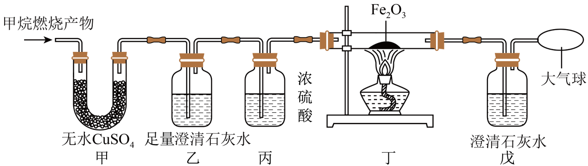

# Chemistry - 题目 168

**ID**: 6ab7680064984f4caabf47435f48cc26
**年级**: Grade 9
**难度**: Medium-Hard
**题型**: Scientific Inquiry

## 题目
天然气是一种重要的燃料，其主要成分是甲烷（CH_{4}），某校化学兴趣小组的同学对甲烷燃烧的产物产生了兴趣，参与探究。​​​​​​​‌（提出问题）：甲烷燃烧后生成哪些物质？（查阅资料）：含碳元素的物质完全燃烧生成CO_{2}，不完全燃烧生成CO；无水CuSO_{4}遇水变蓝。（猜想与假设）：猜想甲：CO_{2}、H_{2}O；猜想乙：CO_{2}、CO、H_{2}O；猜想丙：。（实验探究）：为了验证上述猜想与假设，将甲烷在一定量的O_{2}中燃烧的产物依次通过如图所示装置：（1）甲、乙装置的顺序能否颠倒？（填“能“或“否”），理由是。（2）实验中用纯净O_{2}而不用空气的原因是。（3）实验中观察到甲中无水CuSO_{4}变蓝，乙、戊中澄清石灰水变浑浊，丁中红色粉末变成黑色，由此推断同学猜想成立。（4）装置乙的作用是，写出丁中发生的反应的化学方程式：。（反思与交流）：为避免有毒的CO污染环境，则含碳元素的物质燃烧必须满足的条件是。实验结束，对相关装置进行称量（忽略空气成分对实验的干扰）：甲装置增重3.6 g，乙装置增重2.2 g。则燃烧甲烷的质量为g，写出该实验中甲烷燃烧的化学方程式：。

## 解答

1. 猜想与假设：根据质量守恒定律可知化学反应前后元素的种类不变，反应物是甲烷和氧气，则甲烷不完全燃烧生成的是一氧化碳和水。
2. （1）甲装置是用无水硫酸铜检验产物是否含有水，乙装置是用澄清石灰水检验产物是否含有二氧化碳，甲、乙装置的顺序不能颠倒，这是因为先通过澄清石灰水时会带出水蒸气，影响对产物的检验，就不能证明混合气体中是否有水。
3. （2）由于空气中含有水分和二氧化碳，用空气就无法验证混合气体中是否含有水和二氧化碳，无法证明是混合气体中的水和二氧化碳，还是空气中的水和二氧化碳，干扰实验结果。
4. （3）甲中无水CuSO_{4}变蓝说明混合气体中有水，乙中澄清石灰水变浑浊说明混合气体中含有二氧化碳，乙中足量澄清石灰水有两个作用：验证二氧化碳的存在，完全除去混合气体中的二氧化碳，戊中澄清石灰水变浑浊，丁中红色粉末变成黑色说明混合气体中具有还原性气体，且与氧化铁反应能生成二氧化碳，说明混合气体中含有一氧化碳，由此推断乙同学猜想成立。
5. （4）乙中足量澄清石灰水有两个作用：验证二氧化碳的存在和完全除去混合气体中的二氧化碳；丁中红色粉末变成黑色的反应是一氧化碳和氧化铁在高温下生成铁和二氧化碳，其化学方程式为 ${{3}}{\rm{C}}{\rm{O}}{{+}}{\rm{F}}{\rm{e}}{{}_{{{2}}}}{\rm{O}}{{}_{{{3}}}}\hspace{-0.5em}\begin{array}{}{\underline{{\underline{~~高温~~}}}}\atop{}\end{array}\hspace{-0.5em}{{2}}{\rm{F}}{\rm{e}}{{+}}{{3}}{\rm{C}}{\rm{O}}{{}_{{{2}}}}$ 。
6. 反思与交流：由于可燃物不完全燃烧能生成一氧化碳，污染环境，则要让可燃物完全燃烧，需要充足的氧气。
7. 甲装置增重3.6 g，即产生水的质量为3.6 g，乙装置增重2.2 g，即产生二氧化碳的质量为2.2 g；3.6 g水中氢元素的质量为 ${\rm =}{{3}}{{.}}{{6}}{\rm{\;}}{\rm{g}}\times \frac {2}{18}\times {{1}}{{0}}{{0}}{\rm{\%}}={{0}}{{.}}{{4}}{\rm{\;}}{\rm{g}}$ ，甲烷中氢元素的质量完全转化到水中，因此甲烷的质量为  ${{0}}{{.}}{{4}}{\rm{\;}}{\rm{g}}\div \left ({\frac {{{4}}}{{{1}}{{6}}}\times {{1}}{{0}}{{0}}{\rm{\%}}}\right ){\rm{=}}{{1}}{{.}}{{6}}{\rm{\;}}{\rm{g}}$ 。
8. 则甲烷中碳元素的质量为 ${{1}}{{.}}{{6}}{\rm{\;}}{\rm{g}}{{-}}{{0}}{{.}}{{4}}{\rm{\;}}{\rm{g}}={{1}}{{.}}{{2}}{\rm{\;}}{\rm{g}}{\rm ，2.2}$  g二氧化碳中碳元素的质量为 ${{2}}{{.}}{{2}}{\rm{\;}}{\rm{g}}\times \frac {12}{44}\times {{1}}{{0}}{{0}}{\rm{\%}}{\rm{=}}{{0}}{{.}}{{6}}{\rm{\;}}{\rm{g}}$ ；甲烷燃烧同时生成了一氧化碳，一氧化碳中碳元素的质量为  ${{1}}{{.}}{{2}}{\rm{\;}}{\rm{g}}{{-}}{{0}}{{.}}{{6}}{\rm{\;}}{\rm{g}}{\rm{=}}{{0}}{{.}}{{6}}{\rm{\;}}{\rm{g}}$ ；则生成一氧化碳的质量为  ${{0}}{{.}}{{6}}{\rm{\;}}{\rm{g}}\div \left ({\frac {{{1}}{{2}}}{{{2}}{{8}}}\times {{1}}{{0}}{{0}}{\rm{\%}}}\right ){\rm{=}}{{1}}{{.}}{{4}}{\rm{\;}}{\rm{g}}$ ；在点燃的条件下，甲烷和氧气反应生成水、一氧化碳和二氧化碳，则参加反应的氧气质量为  ${{3}}{{.}}{{6}}{\rm{\;}}{\rm{g}}{{+}}{{2}}{{.}}{{2}}{\rm{\;}}{\rm{g}}{{+}}{{1}}{{.}}{{4}}{\rm{\;}}{\rm{g}}{{-}}{{1}}{{.}}{{6}}{\rm{\;}}{\rm{g}}{\rm{=}}{{5}}{{.}}{{6}}{\rm{\;}}{\rm{g}}$ 。则反应物甲烷、氧气和生成物二氧化碳、一氧化碳、水的分子个数比为  $\frac {{{1}}{{.}}{{6}}{\rm{\;}}{\rm{g}}}{{{1}}{{6}}}{\rm{:}}\frac {{{5}}{{.}}{{6}}{\rm{\;}}{\rm{g}}}{{{3}}{{2}}}{\rm{:}}\frac {{{2}}{{.}}{{2}}{\rm{\;}}{\rm{g}}}{{{4}}{{4}}}{\rm{:}}\frac {{{1}}{{.}}{{4}}{\rm{\;}}{\rm{g}}}{{{2}}{{8}}}{\rm{:}}\frac {{{3}}{{.}}{{6}}{\rm{\;}}{\rm{g}}}{{{1}}{{8}}}{\rm{=}}{{4}}{\rm{:}}{{7}}{\rm{:}}{{2}}{\rm{:}}{{2}}{\rm{:}}{{8}}$ ；即甲烷燃烧的化学方程式为  ${{4}}{\rm{C}}{\rm{H}}{{}_{{{4}}}}{{+}}{{7}}{\rm{O}}{{}_{{{2}}}}\hspace{-0.5em}\begin{array}{}{\underline{{\underline{~~点燃~~}}}}\atop{}\end{array}\hspace{-0.5em}{{2}}{\rm{C}}{\rm{O}}{{}_{{{2}}}}{{+}}{{2}}{\rm{C}}{\rm{O}}{{+}}{{8}}{\rm{H}}{{}_{{{2}}}}{\rm{O}}$ 。

## 知识点

**中文**:
  - 一氧化碳与二氧化碳分离和鉴别
  - 质量守恒定律的内容与应用
  - 实验探究物质的组成成分以及含量

**English**:
  - Separation and Identification of CO and CO2
  - Content and Application of Law of Conservation of Mass
  - Inquiry into Composition and Content of Matter

---
