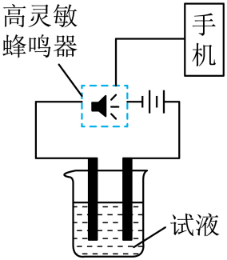
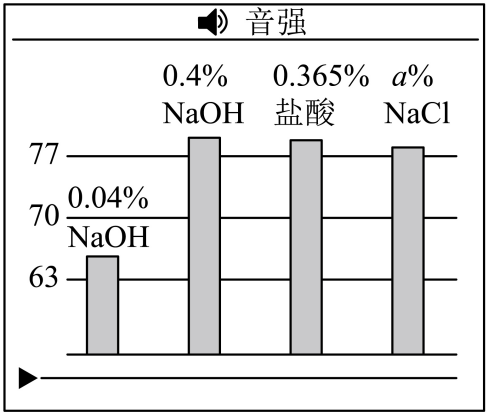
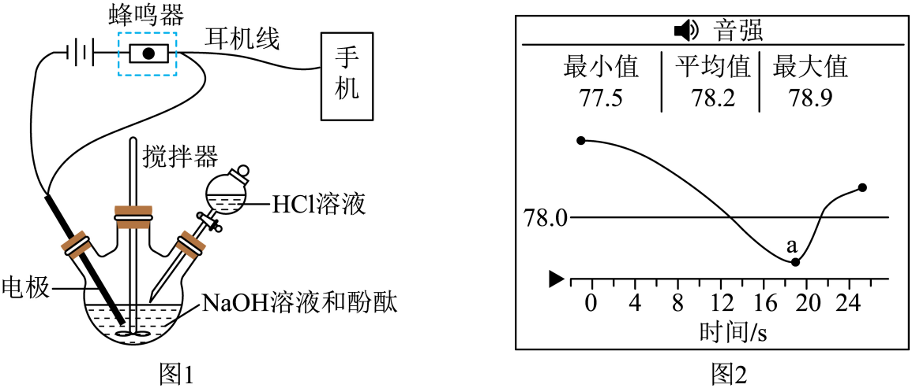

# Chemistry - 题目 257

**ID**: 6d15eb1fa2af4ae588e57b3a8f7a6588
**年级**: Grade 9
**难度**: Medium-Hard
**题型**: Scientific Inquiry

## 题目
兴趣小组利用智能手机的声音传感器与高灵敏蜂鸣器联用开展溶液导电性实验探究。​​​​​​​‌I.初步试验（1）在4个烧杯中分别加入一定量氯化钠溶液、蔗糖溶液、稀盐酸、稀氢氧化钠溶液，如图所示进行实验，观察到蜂鸣器几乎不能发出声音的试液有，说明溶液能导电的原因是有自由移动的。II.深入实验另取4个烧杯中分别加入等体积的溶质质量分数为0.04%的NaOH溶液，以及0.4%的NaOH溶液、0.365%盐酸、a%NaCl溶液(以上溶液密度均近似为1.0g/mL)。分别点击手机APP中的数据采集按钮，采集数据5秒钟，不同溶液自动呈现的声音变化数据如图所示。（2）对比不同浓度氢氧化钠溶液的导电性差异，可得出结论。（3）根据图可推理得出NaCl溶液的浓度a%可能为(填“0.0585%”或“0.585%”)。III.拓展实验如图1所示，向三颈烧瓶中加入20mL40%的NaOH溶液和2滴酚酞试液，分液漏斗中加入0.365%的盐酸，打开分液漏斗旋塞保持每秒3~4滴的速度进行滴加。实验过程中打开磁力搅拌器，接通蜂鸣器电源，手机APP内采集、呈现声音变化数据如图2所示。（4）实验中发生反应的化学方程式为。（5）a点时溶液呈现的颜色为色。24秒时溶液中的溶质为。（6）0～18s时间内，曲线明显下降的主要原因是烧瓶中溶液的。

## 解答

1. （1）蔗糖溶液不导电，蜂鸣器几乎不能发出声音，氯化钠溶液、稀盐酸、稀氢氧化钠溶液能导电，原因有自由移动的离子。
2. （2）对比不同浓度氢氧化钠溶液的导电性差异，氢氧化钠浓度高离子浓度高时导电性好，浓度低离子浓度低时导电性差，可得出结论：相同条件下溶液离子浓度越大导电性越强。
3. （3）加入0.4%的NaOH溶液、0.365%盐酸、a%NaCl溶液(以上溶液密度均近似为1.0g/mL)，分别点击手机APP中的数据采集按钮，采集数据5秒钟，数据相同，说明离子浓度相同，氢氧化钠和氯化钠都是一个分子溶液中产生一个阳离子和一个阴离子，所以氢氧化钠和氯化钠分子数目相同，故 $\frac {1.0{{\rm{g}}}/{{\rm{m}}{\rm{L}}}\times {\rm{V}}{\rm{m}}{\rm{l}}\times 0.4\%}{40}=\frac {1.0{{\rm{g}}}/{{\rm{m}}{\rm{L}}}\times {\rm{V}}{\rm{m}}{\rm{l}}\times {\rm{a}}\%}{58.5}{\rm ，a=0.585}$ 。
4. （4）NaOH溶液中加入0.365%的盐酸，反应生成氯化钠和水，化学方程式为 ${\rm{H}}{\rm{C}}{\rm{l}}{{+}}{\rm{N}}{\rm{a}}{\rm{O}}{\rm{H}}\hspace{-0.5em}\begin{array}{}{\underline{{\underline{~{\,}{\,}{\,}{\,}{\,}{\,}~}}}}\atop{}\end{array}\hspace{-0.5em}{\rm{N}}{\rm{a}}{\rm{C}}{\rm{l}}{{+}}{\rm{H}}{{}_{{{2}}}}{\rm{O}}$ 。
5. （5）a点时音强最小，离子浓度最低，表示氢氧化钠和盐酸恰好完全反应，呈中性，酚酞无色，24秒时稀盐酸过量，溶液中的溶质为氯化钠和盐酸。
6. （6）0～18s时间内曲线明显下降的主要原因离子浓度下降，导电性减弱。

## 知识点

**中文**:
  - 溶液的导电性实验

**English**:
  - Solution Conductivity Experiment

---
