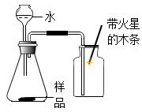

# Chemistry - 题目 196

**ID**: 73f99340358c44229aa6944a4f222c64
**年级**: Grade 9
**难度**: Medium-Hard
**题型**: Scientific Inquiry

## 题目
过氧化钠(Na_{2}O_{2})、过氧化钙(CaO_{2})均是常用的增氧剂。​​​​​​​‌现有一瓶久置的过氧化钠，老师通过简单实验后发现该试剂已经变质。化学兴趣小组欲对瓶中的固体成分进行分析，请你参与探究活动。〖查阅资料〗①过氧化钠与水和二氧化碳均能发生反应，化学方程式分别为2Na_{2}O_{2}＋2H_{2}O=4NaOH＋O_{2}↑、2Na_{2}O_{2}＋2CO_{2}=2Na_{2}CO_{3}＋O_{2}②BaCl_{2}溶液显中性，并能与Na_{2}CO_{3}溶液发生如下反应：BaCl_{2}＋Na_{2}CO_{3}=2NaCl＋BaCO_{3}↓实验一：探究过氧化钠样品的变质程度取适量过氧化钠样品于锥形瓶中，进行如图所示实验。实验结束后，将带火星的木条放在导管口处，观察到，说明过氧化钠已完全变质。实验二：探究变质后固体物质的成分〖作出猜想〗猜想①：仅有NaOH；猜想②：仅有Na_{2}CO_{3}；猜想③：。〖实验验证〗取适量已变质的过氧化钠样品，配成溶液，分装在三支试管里，进行如下实验：实验步骤实验现象实验结论甲同学向第一支试管里滴加几滴酚酞试液溶液变红色甲同学认为猜想①正确乙同学向第二支试管里滴加足量的稀盐酸乙同学认为猜想①错误丙同学向第三支试管里先滴入足量的BaCl_{2}溶液，静置，再取少量上层清液并滴入几滴酚酞试液产生沉淀，上层清液变红色丙同学认为猜想正确〖反思评价〗（1）甲同学的结论不合理，理由是。（2）在乙同学的实验中，首先发生的反应是(写化学方程式)。（3）在丙同学的实验中，酚酞试液也可以用代替，当观察到，也能对猜想作出正确的判断。〖拓展延伸〗CaO_{2}与Na_{2}O_{2}的化学性质相似。下列叙述错误的是(填字母)。

## 解答

1. 实验一：过氧化钠能与水反应生成氢氧化钠和氧气，故带火星的木条不复燃，说明没有氧气生成，说明过氧化钠已经变质；
2. 实验二：作出猜想：过氧化钠能与水反应生成氢氧化钠和氧气，过氧化钠能与二氧化碳反应生成碳酸钠和氧气，故变质后的固体可能是氢氧化钠，也可能是碳酸钠，也可能是氢氧化钠和碳酸钠，故猜想③：NaOH、Na_{2}CO_{3}；
3. 实验验证：实验结论为乙同学认为猜想①错误，故固体中含碳酸钠，碳酸钠能与稀盐酸反应生成氯化钠、二氧化碳和水，故现象为：产生气泡；
4. 向第三支试管里先滴入足量的BaCl_{2}溶液，氯化钡能与碳酸钠反应生成碳酸钡和氯化钠，产生白色沉淀，说明含碳酸钠，静置，再取少量上层清液并滴入几滴酚酞试液，溶液变红，说明含氢氧化钠，则猜想③正确；
5. 反思评价：（1）碳酸钠溶液和氢氧化钠溶液均显碱性，均能使无色酚酞试液变红，故溶液变红，不能说明猜想①正确；
6. （2）在乙同学的实验中，首先发生的反应是氢氧化钠和稀盐酸反应生成氯化钠和水，待氢氧化钠完全反应后，碳酸钠和稀盐酸反应生成氯化钠、二氧化碳和水，氢氧化钠和稀盐酸反应的化学方程式为： ${\rm{H}}{\rm{C}}{\rm{l}}{\rm{+}}{\rm{N}}{\rm{a}}{\rm{O}}{\rm{H}}{\rm{=}}{\rm{N}}{\rm{a}}{\rm{C}}{\rm{l}}{\rm{+}}{\rm{H}}_{{\rm{2}}}{\rm{O}}$ ；
7. （3）氢氧化钠能与硫酸铜反应生成氢氧化铜和硫酸钠，产生蓝色沉淀，故在丙同学的实验中，酚酞试液也可以用硫酸铜溶液代替，当观察到产生蓝色沉淀时，说明含氢氧化钠；
8. 拓展延伸：A、CaO_{2}与Na_{2}O_{2}的化学性质相似，故过氧化钠和过氧化钙均能与空气中的二氧化碳和水反应，故都需要密封保存，不符合题意；
9. B、过氧化钠能与水反应生成氢氧化钠和氧气，氢氧化钠是强碱，具有腐蚀性，不能在水中加入过氧化钠作增氧剂，符合题意；
10. C、过氧化钠与水反应生成氢氧化钠和氧气，故过氧化钙和水反应生成氢氧化钙和氧气，该反应的化学方程式为： ${\rm{2}}{\rm{C}}{\rm{a}}{\rm{O}}_{{\rm{2}}}{\rm{+}}{\rm{2}}{\rm{H}}_{{\rm{2}}}{\rm{O}}{\rm{=}}{\rm{2}}{\rm{C}}{\rm{a}}{\rm{(}}{\rm{O}}{\rm{H}}{\rm{)}}_{{\rm{2}}}{\rm{+}}{\rm{O}}_{{\rm{2}}}\uparrow $ ，不符合题意。
11. 故选B。

## 知识点

**中文**:
  - 药品是否变质的探究

**English**:
  - Inquiry into Deterioration of Reagents

---
