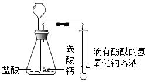

# Chemistry - 题目 297

**ID**: 79a957cbf7bc4a55b285b22d91b11312
**年级**: Grade 9
**难度**: Medium-Hard
**题型**: Scientific Inquiry

## 题目
某研究性小组进行“酸与碱的中和反应”探究实验，发现向NaOH溶液中加入稀盐酸，充分混合后没有明显现象。​​​​​​​‌为了证明它们之间确实发生了反应，小组同学分别设计了下述实验：（1）甲同学提出取少量混合后的溶液尝一尝，若有咸味则说明有NaCl生成，证明NaOH与盐酸发生了反应，但马上遭到其他同学的反对。你认为其他同学反对的理由是。（2）乙同学提出测定混合后溶液的pH，根据测定结果可以判断。请你判断下列结果中，一定能说明NaOH溶液与稀盐酸发生了化学反应的是（填字母）。a．溶液pH变小             b．pH=7                    c．pH<7（3）丙同学取少量NaOH溶液到试管，滴入几滴酚酞溶液，得到红色溶液。再逐滴滴加稀盐酸，至溶液变无色，分成2份，其中一份滴加NaOH溶液，溶液又变为红色；另一份滴加CuSO_{4}溶液，无明显现象。据此得出结论：溶液变无色，说明无色溶液中无NaOH，证明NaOH溶液与稀盐酸发生了反应。〖反思〗乙、丙同学的设计思路本质上相同，都是依据来验证化学反应确实发生了。过了一段时间，同学们意外发现：丙同学实验中试管中溶液的红色又消失了。〖提出问题〗是什么原因导致滴有酚酞的NaOH溶液的红色消失了？〖猜想与假设〗同学们分别做出如下猜想：A同学：可能是酚酞与O_{2}发生了反应；B同学：可能是NaOH溶液与空气中的CO_{2}发生了反应；C同学：可能与NaOH溶液浓度过大有关。〖设计实验〗三位同学分别设计实验验证自己的猜想：（4）A同学：设计了如下实验，请你填写下表。实验步骤设计这一步骤目的实验现象实验结论①将NaOH溶液加热煮沸并迅速冷却溶液变红，过一会儿红色消失甲同学猜想不正确②向冷却后的溶液中滴入酚酞，并滴一些植物油在其上方（5）B同学设计如图装置进行实验，一段时间后，试管中溶液的红色褪去，于是认定自己的猜想正确。其他同学认为乙同学的实验不够严谨，理由是。（6）请你设计实验证明C同学的猜想正确，简述实验操作和现象：。

## 解答

1. （1）其他同学反对的理由：不能尝药品味道，例如氢氧化钠溶液、稀盐酸都具有腐蚀性，不是恰好完全反应时，品尝容易发生安全事故，故填:实验室不能尝药品味道；
2. （2）a.溶液pH变小，不能说明发生了反应，是因为滴加稀盐酸时，氢氧化钠溶液被稀释，也能够导致溶液pH变小；
3. b.pH= 7，说明氢氧化钠消失，能够说明氢氧化钠和稀盐酸发生了反应；
4. c.pH< 7，说明氢氧化钠消失，稀盐酸过量，能够说明氢氧化钠和稀盐酸发生了反应。
5. 故填：bc。
6. 反思：乙、丙同学的设计思路本质上相同，都是依据氢氧化钠消失来验证化学反应确实发生了，故填：氢氧化钠消失。
7. （4）煮沸过程主要目的是除去氧气，所以设计这一步的目的是：验证酚酞是否和氧气发生反应，故填：验证酚酞是否和氧气发生反应；
8. （5）其他同学认为乙同学的实验不够严谨，理由是盐酸易挥发，挥发出的氯化氢能和氢氧化钠反应，也能够导致红色消失，故填：盐酸易挥发，挥发出的氯化氢能和氢氧化钠反应，也能够导致红色消失；
9. （6）实验方案：
10. 实验操作：取适量较大浓度的氢氧化钠溶液于试管中，滴加酚酞试液，一段时间后，加水稀释；
11. 实验结论：较大浓度的氢氧化钠溶液能使红色消失
12. 实验现象：溶液变红色，过一会儿红色消失，一段时间后溶液变红色。
13. 故填：实验操作：取适量较大浓度的氢氧化钠溶液于试管中，滴加酚酞试液，一段时间后，加水稀释；实验现象：溶液变红色，过一会儿红色消失，一段时间后溶液变红色。

## 知识点

**中文**:
  - 中和反应的探究

**English**:
  - Inquiry into Neutralization Reaction

---
