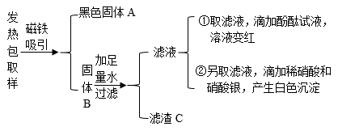
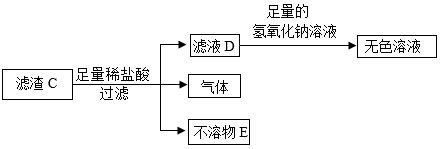
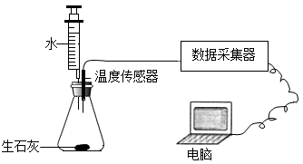

# Chemistry - 题目 262

**ID**: 7aa1af66adb246e3bec15732ec95cf92
**年级**: Grade 9
**难度**: Medium-Hard
**题型**: Scientific Inquiry

## 题目
市场上销售的某种“自热火锅”中有发热包，该发热包遇水后可迅速升温至150℃，保温时间达2~3小时，同学们对此产生了浓厚兴趣，他们对发热包的成分及发热原理进行了以下探究。​​​​​​​‌〖查阅资料〗（1）“发热包”主要由生石灰、铁粉、镁粉、铝粉、炭粉、氯化钠等组成。（2）氢氧化镁和氢氧化铝均为不溶于水的白色固体，氢氧化铝可溶于NaOH溶液。〖成分探究〗步骤一：为了探究发热包的成分，同学们设计了如下实验：〖实验结论〗（1）探究过程发热包样品中有被磁铁吸引的黑色固体A，说明发热包中含有。（2）探究过程①，滴加酚酞溶液后溶液变红，说明发热包中含有，②的现象证明发热包中一定有。步骤二：除上述物质外，还可能存在镁粉、铝粉、炭粉，对此大家提出了以下几种猜想：猜想一：只存在镁粉、铝粉、炭粉中的一种；猜想二：上述三种物质同时存在；猜想三：存在铝粉和炭粉；猜想四：存在镁粉和铝粉；猜想五：。〖实验验证〗同学们又取了步骤一中的滤渣C进行实验，流程如下向滤液D滴加氢氧化钠溶液时，他们观察到开始时有白色沉淀生成，后来又全部消失，最后得到的是无色溶液。〖实验结论〗（1）实验过程中过滤后滤渣E的成分是炭粉。（2）同学们对实验现象进行讨论后，认为猜想正确。〖发热原理探究〗同学们利用下图装置证明发热包放出的热量主要来自生石灰与水的反应。向锥形瓶中加水后发现数据采集器温度示数迅速上升。但温度又很快下降，说明该反应很快结束，不能长时间保温。利用温度传感器探究生石灰与水发生反应的化学方程式为。〖猜想〗大家大胆猜测应该还有其他放热反应存在。〖实验验证〗同学们用铁粉、炭粉和食盐水在锥形瓶中模拟铁的锈蚀实验，不久后发现锥形瓶外壁发烫，并持续较长时间。该现象很好地解释了发热包的保温原理。〖拓展活动〗从发热包中各物质大多都是粉末状（如铁粉、铝粉）来看，影响化学反应速率的因素之一是。

## 解答

1. [实验结论]
2. （1）用磁铁靠近其中一份粉末，发现有黑色物质被磁铁吸引，因为磁铁能吸引铁，证明粉末中含有铁粉；
3. （2）将另一份粉末加水溶解、过滤后，取部分滤液滴入酚酞试液，滤液变红色，氧化钙能与水反应生成氢氧化钙，氢氧化钙溶液显碱性能使酚酞变红，证明原粉末中含生石灰，再向滤液中加入含有稀硝酸的硝酸银溶液，看到白色沉淀生成，是因为氯化钠和硝酸银反应生成了白色沉淀氯化银证明原粉末中含有氯化钠；
4. 步骤二：根据猜想一：只存在镁粉、铝粉、炭粉中的一种；猜想二：上述三种物质同时存在；
5. 猜想三：存在铝粉和炭粉；猜想四：存在镁粉和铝粉；可推出猜想五是：存在镁粉和铝粉；
6. [实验结论]
7. （2）结合实验现象讨论后，认为猜想三正确，理由是：加入足量稀盐酸产生气泡，是因为铝、镁或铝和镁和稀盐酸反应生成了氢气，有不溶物D，说明样品中含有炭粉，加入足量氢氧化钠溶液，开始时有白色沉淀生成，后来又全部消失，说明滤液B中不含有镁离子，即样品中不含有镁，则样品中含有铝粉；
8. [发热原理探究]
9. 生石灰与水发生反应生成氢氧化钙，反应的化学方程式为：CaO+H_{2}O=Ca（OH）_{2}；
10. [拓展活动]
11. 发热包中各物质大多都是粉末状，增大反应物间的接触面积，使反应更充分，加快了化学反应速率。

## 知识点

**中文**:
  - 实验探究物质变化的条件和影响物质变化的因素
  - 实验探究物质的组成成分以及含量

**English**:
  - Inquiry into Conditions and Factors of Material Change
  - Inquiry into Composition and Content of Matter

---
