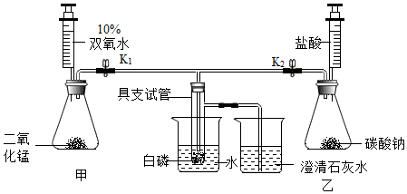

# Chemistry - 题目 72

**ID**: 932d4edf51644d4f8483f450f0de034b
**年级**: Grade 9
**难度**: Medium-Hard
**题型**: Scientific Inquiry

## 题目
在老师的指导下，化学兴趣小组利用下列装置进行了“可燃物燃烧的条件”的探究实验。​​​​​​​‌[实验目的]探究可燃物燃烧的条件[实验步骤]①将所需仪器按照装置图连接起来；②打开K_{1}和K_{2}，向上拉动任意一支注射器的活塞；③将实验所需药品加入对应的仪器中；④将装有适量白磷的具支试管放入冷水中；⑤打开K_{1}，关闭K_{2}，往装置甲中加入适量的双氧水；⑥关闭K_{1}，打开K_{2}，往装置乙中加入适量的盐酸；⑦将装有适量白磷的具支试管放入80℃的热水中；⑧打开K_{1}，关闭K_{2}，往装置甲中加入适量双氧水；⑨关闭K_{1}，打开K_{2}，往装置乙中加入适量的盐酸。[问题解答](1)实验步骤②的目的是。(2)在实验步骤⑥中，具支试管中氧气已经排尽的实验现象是。(3)能看到白磷燃烧起来的实验步骤是（填序号）。[实验结论](4)可燃物燃烧必须同时满足两个条件：与氧气接触、。

## 解答

1. （2）在实验步骤⑥中，关闭K_{1}，打开K_{2}，往装置乙中加入适量的盐酸，碳酸钠和盐酸反应生成二氧化碳，二氧化碳能与氢氧化钙反应生成碳酸钙和水，故澄清石灰水变浑浊，说明具支试管中氧气已经排尽；
2. （3）实验步骤⑦中，将装有适量白磷的具支试管放入80℃的热水中；此时白磷温度达到了着火点，实验步骤⑧中，打开K_{1}，关闭K_{2}，往装置甲中加入适量双氧水，过氧化氢在二氧化锰的催化下分解生成氧气，此时白磷与氧气接触，温度达到了着火点，燃烧，故能看到白磷燃烧起来的实验步骤是⑧；
3. （4）实验步骤⑤中白磷与氧气接触，温度没有达到着火点，不燃烧，步骤⑧中白磷与氧气接触，温度达到了着火点，燃烧，对比⑤⑧可得出燃烧需要温度达到可燃物的着火点，步骤⑨中白磷温度达到了着火点，但是隔绝氧气，不燃烧，对比步骤⑧⑨，说明燃烧需要与氧气接触。

## 知识点

**中文**:
  - 燃烧条件与灭火原理探究

**English**:
  - Inquiry into Combustion Conditions and Extinguishing Principles

---
