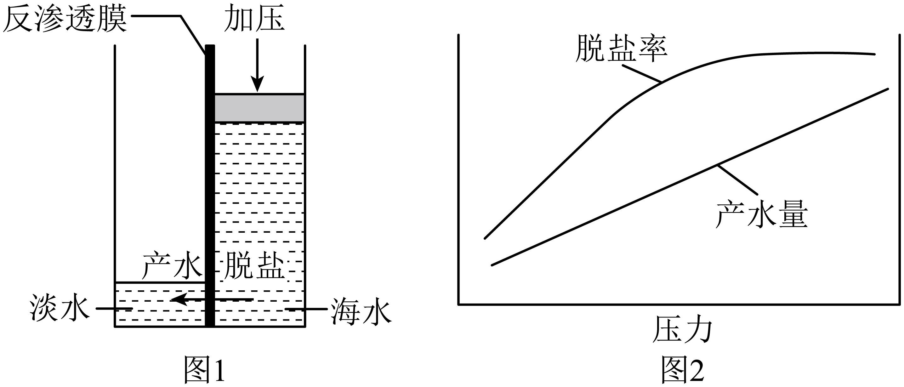

# Chemistry - 题目 343

**ID**: aa69f1bebc484863a21facbc8a673cc6
**年级**: Grade 9
**难度**: Medium-Hard
**题型**: Scientific Inquiry

## 题目
海洋是巨大的资源宝库。​​​​​​​‌在一次研学活动中，某校化学小组的同学在老师带领下到沿海城市，就海洋资源的种类、开发利用及环境保护等展开了项目式问题探究。任务一：了解海洋资源种类【实地考查】同学们参观了海洋博物馆，了解海洋中丰富的海水资源、生物资源、化学资源、矿产资源和能源资源等。【小组交流】海洋中有氯化钠、氯化镁、硫酸镁等化学资源。任务二：认识海水资源利用【教师指导】反渗透膜淡化海水已成为有效缓解淡水资源匮乏的技术之一，其原理如图1所示。进水压力对反渗透膜脱盐率与产水量的影响如图2所示。【交流讨论】（1）分析图2得出的结论有(答一点)。任务三：探究海洋化学资源开发【咨询专家】海水制碱的主要过程：先蒸发海水制得食盐，在饱和食盐水中通入氨气和二氧化碳得到碳酸氢钠固体，再加热碳酸氢钠制得纯碱碳酸钠。【提出问题】制得的纯碱中是否含有氯化钠？【查阅资料】AgCl和 ${\rm{A}}{\rm{g}}{{}_{2}}{\rm{C}}{\rm{O}}{{}_{3}}$ ，均为不溶于水的白色固体。【进行实验】（2）同学们取少量纯碱样品，设计方案，并进行如下探究：实验操作实验现象实验结论取少量样品于试管，加足量水充分溶解后，再滴加足量稀硝酸和几滴(填名称)溶液样品中含有氯化钠【反思评价】（3）加入足量稀硝酸的目的是。（4）证明样品中含有氯化钠的化学方程式是。任务四：洞悉海洋环境保护【走访调查】该城市近海曾发生大面积赤潮，给海洋环境造成极大危害。赤潮的发生主要源于藻类植物的快速繁殖，而水体富营养化是藻类生长旺盛的主要原因。【分析研讨】（5）请你提一条防止海洋环境污染合理化建议。成果分享：通过探究学习，同学们认识到合理开发海洋资源和保护海洋环境，对于促进我国经济和社会可持续发展意义重大。

## 解答

1. （1）观察图2，我们看到随着进水压力的增大，反渗透膜的脱盐率在上升，产水量也在增加。所以可以得出的结论例如：在一定范围内，进水压力越大，反渗透膜的脱盐率越高（或在一定范围内，进水压力越大，反渗透膜的产水量越高 ）。故填：随着进水压力的增加，脱盐率升高，产水量也增大。
2. （2）要检验制得的纯碱中是否含有氯化钠，因为氯化钠中的氯离子能与硝酸银溶液反应生成不溶于稀硝酸的氯化银白色沉淀。所以应滴加足量稀硝酸和几滴硝酸银溶液。如果样品中含有氯化钠，那么会观察到产生白色沉淀。故填：硝酸银；有白色沉淀生成。
3. （3）因为纯碱（碳酸钠）能与硝酸银反应生成碳酸银沉淀，碳酸银沉淀也为白色，但碳酸银能与稀硝酸反应而溶解，所以加入足量稀硝酸的目的是除去样品中的碳酸钠，防止对氯化钠的检验产生干扰。故填：除尽样品中碳酸钠，以防对氯化钠的检验造成干扰。
4. （4）氯化钠与硝酸银反应生成氯化银沉淀和硝酸钠，化学方程式为： ${\rm{A}}{\rm{g}}{\rm{N}}{\rm{O}}{{}_{3}}+{\rm{N}}{\rm{a}}{\rm{C}}{\rm{l}}={\rm{A}}{\rm{g}}{\rm{C}}{\rm{l}}\downarrow +{\rm{N}}{\rm{a}}{\rm{N}}{\rm{O}}{{}_{3}}$ 。
5. （5）防止海洋环境污染可以采取很多措施，比如工业废水处理达标后再排放，因为工业废水中可能含有重金属、有机物等污染物，若直接排放会污染海洋；生活污水集中处理后排放，生活污水中也含有大量的营养物质和有害物质；合理使用化肥和农药，防止过量的氮、磷等营养元素和农药残留流入海洋，引发赤潮等问题。这里可以写工业或生活废水处理达标后排放（答案合理即可）。故填：生活污水集中处理后再排放（合理即可）。

## 知识点

**中文**:
  - 海水制碱
  - 盐的化学性质
  - （跨学科）海洋资源的综合利用与制盐

**English**:
  - Production of Alkali from Seawater
  - Chemical Properties of Salts
  - (Interdisciplinary) Utilization of Marine Resources and Salt Production

---
