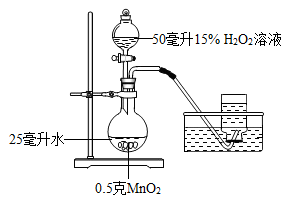

# Chemistry - 题目 16

**ID**: aee6c520686a4691a3f14dc3db91ae78
**年级**: Grade 9
**难度**: Medium-Hard
**题型**: Scientific Inquiry

## 题目
小悦和小涵同学发现：若用装有占瓶容积60%的水的集气瓶倒置在水槽中收集氧气，把瓶中的水刚好全部排出时得到的气体就能使带火星的木条复燃，为了找到能使带火星木条复燃的氧气含量最小值，他们进行了如下探究：〖设计实验〗小悦设计了如下图的装置，该装置的圆底烧瓶中先放入25毫升水的目的是。​​​​​​​‌MnO_{2}在实验中的作用是。〖实验研究〗第一组实验：取3只集气瓶，编号为①②③，分别装入占瓶容积15%、30%和45%的水，盖上毛玻璃片倒置在水槽中。当时，再将导管口伸入集气瓶，并把瓶中的水刚好全部排出，然后将相同的3支带火星木条分别插入①~③号瓶中，记录实验现象。在认真分析了第一组实验现象后，小悦又做了第二组实验，并记录实验现象。两组实验数据和现象见下表：实验分组第一组第二组实验序号①②③④⑤⑥水占瓶容积/%1530453834带火星木条状况亮很亮复燃复燃很亮分析上述两组实验现象后，小涵认为还不能确定能使带火星木条复燃的氧气含量最小值，需继续进行实验，结合上表中实验数据，请你分析，实验序号⑥的集气瓶内水占瓶容积应该是%。〖实验结论〗（1）瓶中的水刚好全部排出后，第二组④瓶中氧气的体积分数为%（精确到1%）。（2）再经过数次实验并精密的计算后得出：能使带火星木条复燃的氧气含量最小值为48.7%。〖反思〗他们认为在实验室制取氧气的实验中，采用向上排气法方法收集氧气时，在验满时看到带火星的木条在瓶口刚好复燃时，为提高瓶中的氧气的浓度，此时应该采取的实验操作是。

## 解答

1. 设计实验：该装置的圆底烧瓶中先放入25毫升水，可以稀释H_{2}O_{2}溶液，减缓反应速率；
2. 在该反应中，二氧化锰是催化剂，可以起到催化作用；
3. 实验研究：第一组实验：用排水法收集气体，应等气泡连续均匀冒出时，再将导管口伸入集气瓶，并把瓶中的水刚好全部排出，因为一开始排出的是空气；
4. 通过第一组实验可以得出，水占瓶容积在30%和45%之间，带火星的木条可能复燃，通过第二组实验可知，水占瓶容积在34%和38%之间时，带火星的木条可能复燃，故要想确定能使带火星木条复燃的氧气含量最小值，实验序号⑥的集气瓶内水占瓶容积应该是36%；
5. 实验结论：（1）第二组④瓶中氧气的体积分数为：38%+（1-38%）×21%≈51%或38%+（1-38%）× $\frac {1}{5}$ ≈50%；
6. 反思：由以上分析可知，当带火星的木条复燃时，氧气不一定集满，故采用向上排气法方法收集氧气时，在验满时看到带火星的木条在瓶口刚好复燃时，为提高瓶中的氧气的浓度，此时应该采取的实验操作是：适当延长收集时间。

## 知识点

**中文**:
  - 木炭在氧气中的燃烧及其实验
  - 氧气的检验与验满

**English**:
  - Combustion of Charcoal in Oxygen and Experiment
  - Testing and Verification of Oxygen

---
